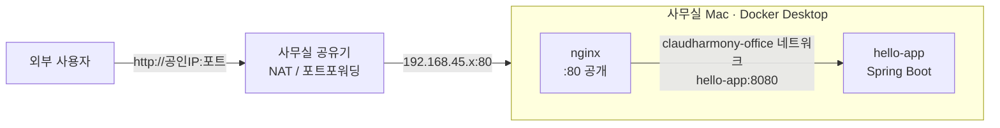

# 01. 아키텍처

## 한 줄 요약

사무실 Mac 한 대 위에서 **Terraform → Docker** 로 `nginx(80) → Spring Boot(8080, 내부 전용)` 를 구성한다.
도메인 구매 전이므로 **공인 IP + 공유기 포트포워딩** 으로 외부 접근한다.

## 요청 흐름



- 외부에 열리는 포트는 **nginx 80 하나뿐**. Spring Boot 컨테이너는 호스트 포트를 바인딩하지 않는다.
- nginx 는 Docker 내장 DNS(`127.0.0.11`)로 upstream 을 **매 요청 resolve** → 앱 컨테이너가 재생성되어도 502 없음.

## 디렉토리 구조

```
infra/
├── apps/                     # 배포 대상 애플리케이션 소스
│   └── hello/                # Spring Boot 3.5 / Java 21 ("안녕하세요 클라우드 하모니")
├── modules/                  # 재사용 Terraform 모듈 (= 클라우드 서비스 단위)
│   ├── network/              # VPC 역할      → docker_network
│   ├── app-service/          # Compute 역할  → docker build + docker_container (내부 전용)
│   └── reverse-proxy/        # Load Balancer → nginx 컨테이너 + 라우팅 템플릿
├── envs/
│   └── office/               # 사무실 환경 (루트 모듈)
│       ├── main.tf
│       ├── services.auto.tfvars.json   # ★ 서비스 카탈로그 (어드민 콘솔이 수정할 파일)
│       └── terraform.tfvars.example
├── scripts/infra.sh          # plan/apply/status/logs/check 래퍼
└── docs/                     # 이 문서 (md + index.html)
```

## 클라우드 개념 매핑

| 클라우드 (AWS / GCP)            | 여기서의 구현                         | 모듈                 |
|---------------------------------|---------------------------------------|----------------------|
| VPC / VPC Network               | Docker bridge 네트워크                | `modules/network`    |
| EC2·ECS / Cloud Run             | Docker 컨테이너 (이미지 로컬 빌드)    | `modules/app-service`|
| ALB / Cloud Load Balancing      | nginx 리버스 프록시 (경로 라우팅)     | `modules/reverse-proxy` |
| ECR / Artifact Registry         | 로컬 Docker 이미지 (`claudharmony/*`) | (향후 레지스트리)    |
| Resource Tags / Labels          | Docker label `claudharmony.*`         | 전 모듈 공통         |
| Internet Gateway + Public IP    | 사무실 공유기 NAT + 포트포워딩        | 수동 (02 문서)       |

## 설계 결정

| 결정 | 이유 |
|------|------|
| 이미지 빌드는 `local-exec docker build` | kreuzwerker/docker provider 의 legacy builder 가 Docker Desktop(containerd image store)에서 `invalid response status 403` 으로 실패. CLI(BuildKit) 빌드는 정상 |
| 이미지 태그 = 소스 해시(12자) | 소스가 바뀔 때만 재빌드·재배포. `latest` 태그도 함께 붙임 |
| 서비스는 JSON 카탈로그로 선언 | 어드민 콘솔이 HCL 을 건드리지 않고 데이터만 바꾸면 되게 하기 위함 (04 문서) |
| 모든 리소스에 `claudharmony.*` label | 콘솔/스크립트에서 "Terraform 이 관리하는 리소스" 를 조회하기 위함 |
| state 는 당분간 local | 1인·1대 운영. 콘솔 단계에서 원격 backend 로 전환 |
