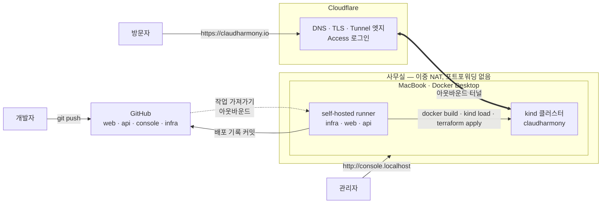
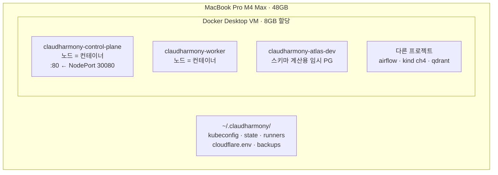
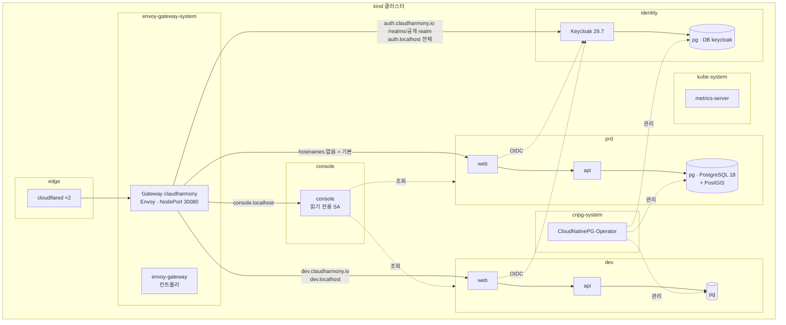
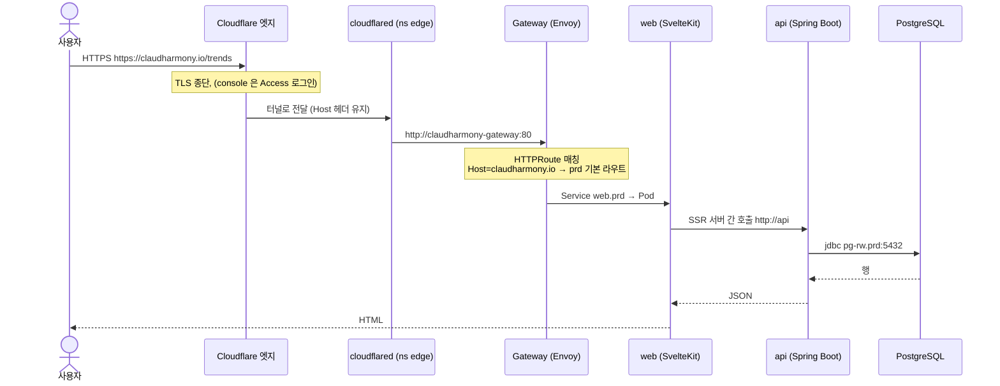
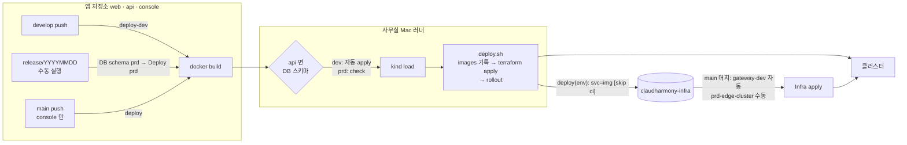
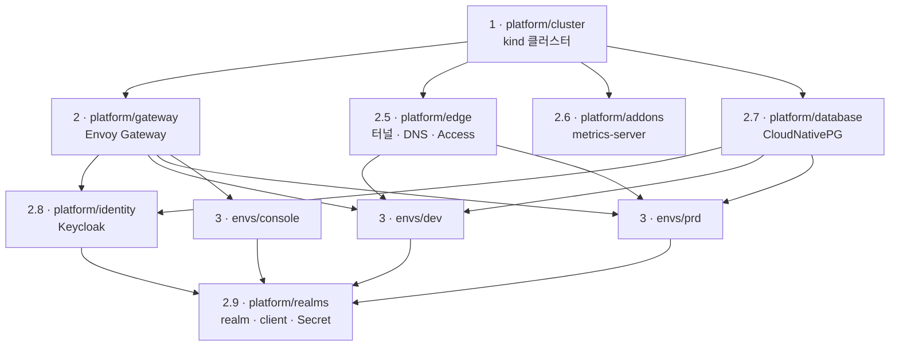

# 01. 아키텍처 — 전체 구성도

> 기준: 2026-10-24 실제 클러스터 상태. 처음 보는 사람은 [학습 가이드](11-learning-guide.md) 순서로 읽기를 권한다.

## 한 줄 요약

사무실 Mac 한 대의 Docker 위에 **Kubernetes v1.37 (kind)** 클러스터를 두고, **Terraform** 으로 전부 관리한다.
외부 공개는 **Cloudflare Tunnel + 도메인 `claudharmony.io`**, 앱 배포는 **GitHub Actions (self-hosted runner)**, 관리는 **관리자 콘솔**.

## 1. 전체 그림 (System Context)

**핵심 포인트**: 사무실로 **들어오는 연결은 하나도 없다**. 터널(cloudflared)과 러너 모두 **안에서 바깥으로** 연결한다 → 이중 NAT·공유기 권한 문제와 무관.

## 2. 물리 / 노드 구성

| 항목 | 값 |
|------|----|
| 노드 | control-plane 1 + worker 1 (Kubernetes **v1.37.0**) |
| 호스트 포트 | Mac `:80` → control-plane `:30080` (Envoy Gateway NodePort) |
| 접속 정보 | `~/.claudharmony/kubeconfig` (context `kind-claudharmony`, `~/.kube/config` 에도 병합) |
| Terraform state | `~/.claudharmony/state/<stack>.tfstate` (저장소 밖) |

## 3. 논리 구성 — Namespace 별

| Namespace | 들어 있는 것 | 만든 곳 |
|-----------|--------------|---------|
| `envoy-gateway-system` | Envoy Gateway 컨트롤러, Gateway(Envoy Pod), NodePort Service | `platform/gateway` |
| `edge` | cloudflared ×2, 터널 토큰 Secret | `platform/edge` |
| `cnpg-system` | CloudNativePG Operator | `platform/database` |
| `kube-system` | metrics-server (+ K8s 기본 구성요소) | `platform/addons` |
| `identity` | Keycloak, 전용 PostgreSQL `pg`(DB `keycloak`), HTTPRoute 공개/관리 | `platform/identity` (+ 설정 `platform/realms`) |
| `prd` / `dev` | web, api, PostgreSQL `pg` (Service `pg-rw/ro/r`, Secret `pg-app/pg-readonly`) | `envs/prd`, `envs/dev` |
| `console` | 관리자 콘솔, ServiceAccount + 읽기 전용 ClusterRole | `envs/console` |

## 4. 요청 흐름

| 주소 | 어디로 | 비고 |
|------|--------|------|
| https://claudharmony.io, www | prd web | 기본(catch-all) 라우트 |
| https://dev.claudharmony.io | dev web | hostname 라우트 |
| http://localhost, http://192.168.45.214 | prd web | 사무실 |
| http://dev.localhost | dev web | 사무실 Mac |
| http://console.localhost | console | 사무실 Mac (공개 주소는 Access 준비 후) |
| `/actuator/**` | → `/` 로 리다이렉트 | 외부 비공개 |

## 5. 배포 흐름

## 6. Terraform 스택과 의존 관계

| 스택 | 만드는 것 | provider | 적용 |
|------|-----------|----------|------|
| `platform/cluster` | kind 클러스터 (노드 2) | local + kind CLI | 수동 (재생성 주의) |
| `platform/gateway` | Envoy Gateway, GatewayClass, EnvoyProxy, Gateway | helm, kubectl | main 머지 시 자동 |
| `platform/edge` | Cloudflare 터널·ingress·DNS(·Access), cloudflared ×2 | cloudflare, kubernetes | 수동 (토큰 필요) |
| `platform/addons` | metrics-server | helm | 수동 |
| `platform/database` | CloudNativePG Operator | helm | 수동 |
| `platform/identity` | Keycloak (Deployment·Service·HTTPRoute) + 전용 DB | kubernetes, kubectl | 수동 |
| `platform/realms` | realm·role·client·계정, 앱 Namespace에 `keycloak-*` Secret | **keycloak**, kubernetes | 수동 (port-forward) |
| `envs/dev`, `envs/prd` | Namespace, web/api (Deployment·Service·HTTPRoute), PostgreSQL | kubernetes, kubectl | dev 자동 / prd 수동, 앱 배포 시 |
| `envs/console` | 콘솔 + RBAC | kubernetes, kubectl | 콘솔 배포 시 |

모듈: `modules/k8s/{env, app, postgres, tunnel}` — env 하나 = Namespace + 서비스 카탈로그(`services.auto.tfvars.json`) + 배포 기록(`images.auto.tfvars.json`) + DB.

## 7. 데이터

| 무엇 | 어디 | 관리 |
|------|------|------|
| 서비스 DB | PostgreSQL 18.6 + PostGIS 3.6.4, 환경별 `pg` (5Gi) | CloudNativePG, 스키마는 api `db/schema.sql` (**Atlas**) |
| 스키마 변경 | dev 자동, prd `DB schema prd` (계획·확인문구·백업) | `scripts/db-schema.sh` |
| 백업 | prd 스키마 적용 직전 pg_dump → `~/.claudharmony/backups/` | ⏳ 정기 백업(R2) 예정 |
| 블로그 글 | api 저장소 `src/main/resources/posts/*.md` | Git |

## 8. 보안 경계

| 경계 | 장치 |
|------|------|
| 인터넷 → 사무실 | 들어오는 포트 없음. Cloudflare 터널만 (TLS 는 엣지) |
| 콘솔 공개 주소 | Cloudflare Access 이메일 로그인 (⏳ 토큰 권한 추가 후) → 이후 Keycloak `admin` 역할로 대체 검토 |
| 로그인 | Keycloak — 인터넷에는 `/realms/<공개 realm>`·`/resources`만, `/admin`·master realm은 `auth.localhost`(사무실 Mac) 전용 — [인증 서버](12-identity.md) |
| 앱 → DB | 클러스터 내부만. 앱 계정 `app`, 조회 계정 `readonly`, 비밀번호는 Secret |
| 콘솔 → K8s | ServiceAccount 읽기 전용, **Secret 접근 불가** |
| 러너 → infra 저장소 | 저장소 하나 전용 SSH deploy key (443 포트) |
| public infra 저장소 | 외부 기여자 워크플로 승인 필수, 문서에 IP/MAC/토큰 없음 |
| 자격증명 | `~/.claudharmony/cloudflare.env` (600), kubeconfig, deploy key — 전부 저장소 밖 |

## 9. 버전 (2026-10-24)

| 구성요소 | 버전 |
|----------|------|
| Kubernetes / kind / kubectl | v1.37.0 / v0.33.0 / v1.37.1 |
| Envoy Gateway / Gateway API | v1.9.2 / v1 |
| CloudNativePG / PostgreSQL / PostGIS | 1.30.1 / 18.6 / 3.6.4 |
| cloudflared | 2025.10.0 |
| metrics-server chart | 3.14.0 |
| Atlas | 1.3.3-community |
| Keycloak / Terraform provider | 26.7.5 / keycloak 5.10 |
| Terraform / providers | 1.15 / kubernetes 3.3, helm 3.x, kubectl 2.x, cloudflare 5.27 |
| 앱 | web SvelteKit 3 (Node 24) · api Spring Boot 4.1.2 (Java 25) · console Spring Boot 4.1.2 |

## 10. 설계 결정 요약

| 결정 | 이유 |
|------|------|
| kind (Docker 안의 K8s) | Mac 한 대에서 가장 가볍고, 나중에 k3s/EKS 로 `platform/cluster` 만 교체 |
| 단계별 Terraform state | CRD 설치(2단계)가 앱(3단계) 전에 필요, 배포가 클러스터를 건드리지 않게 |
| Gateway API (ingress-nginx 아님) | ingress-nginx 2026-03 retire, 역할 분리(GatewayClass/Gateway ↔ HTTPRoute) |
| `externalTrafficPolicy: Cluster` | 호스트 포트는 control-plane 에만 연결, Envoy Pod 는 worker 에 있음 |
| Cloudflare Named Tunnel | 이중 NAT, 고정 주소 + TLS, 커넥터 이중화 |
| 서비스 카탈로그(JSON) | 콘솔이 HCL 대신 데이터만 바꾸게 |
| 배포 기록을 Git 커밋으로 | 무엇이 떠 있는지 이력, 롤백 = 되돌리기 커밋 |
| 레지스트리 없이 `kind load` | 빌드·실행이 같은 Mac |
| DB 는 저장·조회만, 스키마는 Atlas 선언형 | 운영에서 앱 기동 시 자동 마이그레이션 금지 |
| 콘솔 읽기 전용부터 | 변경은 Git → Terraform 경로로만 (2단계) |
