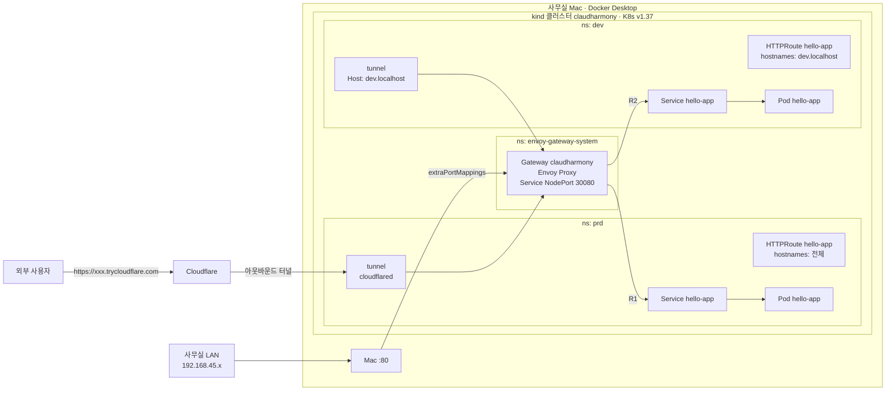
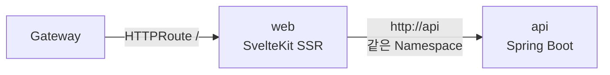

# 01. 아키텍처

## 한 줄 요약

사무실 Mac 위의 **Kubernetes v1.37 (kind)** 클러스터에 **Envoy Gateway (Gateway API)** 를 두고,
`dev` / `prd` **Namespace** 에 Spring Boot 앱을 올린다. 전부 **Terraform** 으로 관리하고,
사무실이 이중 NAT 라서 외부 공개는 **Cloudflare Tunnel** 로 한다.

## 요청 흐름



| 접속 경로 | prd | dev |
|-----------|-----|-----|
| 외부 | `scripts/infra.sh prd url` 의 주소 | `scripts/infra.sh dev url` 의 주소 |
| 이 Mac | http://localhost/ | http://dev.localhost/ |
| 사무실 LAN | http://192.168.45.214/ | (Host 헤더 필요 — 터널 사용) |

- 호스트에 열린 포트는 **80 하나** (kind control-plane 노드의 30080 으로 연결).
- 어느 환경으로 갈지는 **Host 헤더**로 나뉜다. prd 라우트는 hostnames 가 비어 있어서 기본값(catch-all)이 되고, dev 는 `dev.localhost` 일 때만 매칭된다.
- dev 터널은 `--http-host-header dev.localhost` 로 Host 를 바꿔서 Gateway 로 보낸다.
- `/actuator/**` 는 HTTPRoute 에서 `/` 로 리다이렉트 → 외부 비공개. Pod 의 liveness/readiness probe 는 kubelet 이 Pod 에 직접 호출하므로 영향 없음.

## 계층 구조 (3단계)

| 단계 | 디렉토리 | 만드는 것 | 바뀌는 빈도 | 적용 |
|------|----------|-----------|-------------|------|
| 1 | `platform/cluster` | kind 클러스터 (노드 2대) | 거의 안 바뀜 | 수동 |
| 2 | `platform/gateway` | Envoy Gateway, GatewayClass, Gateway | 가끔 | 수동 |
| 3 | `envs/dev`, `envs/prd` | Namespace, Deployment, Service, HTTPRoute, 터널 | 배포마다 | dev 자동 / prd 수동 |

각 단계는 **별도 Terraform state** (`~/.claudharmony/state/<stack>.tfstate`) 를 가진다.
나눈 이유: CRD(GatewayClass 등)는 2단계에서 설치되므로 3단계가 plan 될 때 이미 존재해야 하고,
배포(3단계)가 실수로 클러스터(1단계)를 건드리지 못하게 하기 위함.

## 디렉토리 구조

```
infra/
├── platform/
│   ├── cluster/        # 1단계: kind 클러스터 (terraform_data + kind CLI)
│   └── gateway/        # 2단계: Envoy Gateway (helm) + GatewayClass/Gateway/EnvoyProxy (kubectl)
├── modules/
│   ├── k8s/
│   │   ├── env/        # 한 환경 = Namespace + 서비스들 + 터널
│   │   ├── app/        # Deployment + Service + HTTPRoute
│   │   └── tunnel/     # cloudflared Deployment
│   └── docker/         # (참고용) K8s 이전 Docker 버전 모듈 — 사용 안 함
├── envs/
│   ├── dev/            # 3단계: services.auto.tfvars.json(카탈로그) + images.auto.tfvars.json(배포 기록)
│   └── prd/
├── scripts/
│   ├── infra.sh        # <cluster|gateway|dev|prd> <plan|apply|status|logs|url|check>
│   ├── deploy.sh       # CI 가 호출: kind load → images 갱신 → apply → 기록 커밋
│   ├── setup-runner.sh # self-hosted runner 등록
│   ├── build_docs.py   # docs/*.md → docs/index.html
│   └── sync_obsidian.py
├── .github/workflows/infra-apply.yml
└── docs/
```

앱 코드는 서비스별 별도 저장소 (private) — [CI/CD 문서](06-cicd.md) 참고.

| 서비스 | 저장소 | 스택 | 노출 |
|--------|--------|------|------|
| `web` | claudharmony-web | SvelteKit 3 / Node 24, :3000 | 외부 `/` |
| `api` | claudharmony-api | Spring Boot 4.1.2 / Java 25, :8080 | 내부 전용 (`http://api`) |
| `hello-app` | claudharmony-homepage | Spring Boot 3.5 / Java 21 | 외부 `/` — web 전환 후 제거 |



## 클라우드 개념 매핑

| AWS | GCP | 여기 (Kubernetes) | 정의 위치 |
|-----|-----|-------------------|-----------|
| EKS 클러스터 | GKE 클러스터 | kind 클러스터 `claudharmony` | `platform/cluster` |
| ALB 타입 | Cloud Load Balancing | **GatewayClass** `claudharmony` | `platform/gateway` |
| ALB + 리스너 :80 | Forwarding rule | **Gateway** `claudharmony` | `platform/gateway` |
| 리스너 규칙 (경로/호스트) | URL map | **HTTPRoute** | `modules/k8s/app` |
| 계정 / VPC | 프로젝트 | **Namespace** `dev`, `prd` | `modules/k8s/env` |
| ECS Service / ASG | Cloud Run / MIG | **Deployment** (+ReplicaSet, Pod) | `modules/k8s/app` |
| Target Group / 내부 DNS | Backend service | **Service** (ClusterIP) | `modules/k8s/app` |
| ECR | Artifact Registry | (지금) `kind load` / (나중) 레지스트리 | `scripts/deploy.sh` |
| Internet Gateway | Cloud NAT/외부 IP | Cloudflare Tunnel | `modules/k8s/tunnel` |
| Tags | Labels | Labels `app.kubernetes.io/*`, `claudharmony.io/*` | 전 모듈 |

## 버전 (2026-10-24)

| 구성요소 | 버전 | 비고 |
|----------|------|------|
| Kubernetes | **v1.37.0** | `kindest/node` digest 고정 |
| kind | v0.33.0 | |
| kubectl | v1.37.1 | Homebrew |
| Envoy Gateway | v1.9.2 | Helm `oci://docker.io/envoyproxy/gateway-helm` |
| Gateway API | v1 (CRD 는 Envoy Gateway 차트에 포함) | |
| Terraform | 1.15.x | |
| providers | kubernetes ~> 3.3.0, helm ~> 3.0, alekc/kubectl ~> 2.1, local ~> 2.5 | |
| 앱 | Spring Boot 3.5.6 / Java 21 | |

> **왜 ingress-nginx 가 아니라 Gateway API?** ingress-nginx 프로젝트는 2026년 3월 지원 종료(retire)됐고,
> Kubernetes 의 차세대 표준은 Gateway API 다. 역할(인프라 담당 GatewayClass/Gateway ↔ 앱 담당 HTTPRoute)이
> 분리돼 있어 "콘솔에서 앱 팀이 라우트만 관리" 하는 구조와도 잘 맞는다.

## 설계 결정

| 결정 | 이유 |
|------|------|
| kind (Docker 안의 K8s) | 이미 Docker Desktop 이 있고, 학습·로컬 운영에 가장 가볍다. 나중에 k3s/EKS 로 옮겨도 3단계 모듈은 거의 그대로 |
| kubeconfig 분리 (`~/.claudharmony/kubeconfig`) | 기존 `~/.kube/config` 의 current-context(다른 프로젝트 `kind-ch4`)를 바꾸지 않기 위해 |
| Envoy Service `NodePort 30080` + `externalTrafficPolicy: Cluster` | kind 에는 LoadBalancer 가 없다. 호스트 포트는 control-plane 노드에만 연결되는데 Envoy Pod 는 worker 에 있으므로 Cluster 정책이 필요 ([작업 기록](07-worklog.md) 트러블슈팅 참고) |
| HTTPRoute 는 `alekc/kubectl` provider | `kubernetes_manifest` 는 plan 시점에 CRD 가 있어야 하고 diff 가 까다롭다. kubectl provider 는 YAML 그대로 적용 |
| 이미지 레지스트리 없이 `kind load` | 배포가 같은 Mac 에서 일어나므로 레지스트리가 필요 없다. 멀티 노드/원격 클러스터로 가면 GHCR 도입 |
| Namespace 라벨 `claudharmony.io/gateway-access=true` 가 있어야 라우트 연결 | 아무 Namespace 나 공용 Gateway 에 라우트를 붙이지 못하게 (Gateway 의 allowedRoutes selector) |
| 서비스 목록 = JSON 카탈로그 | 어드민 콘솔이 HCL 대신 데이터만 바꾸게 ([로드맵](04-admin-console-roadmap.md)) |
