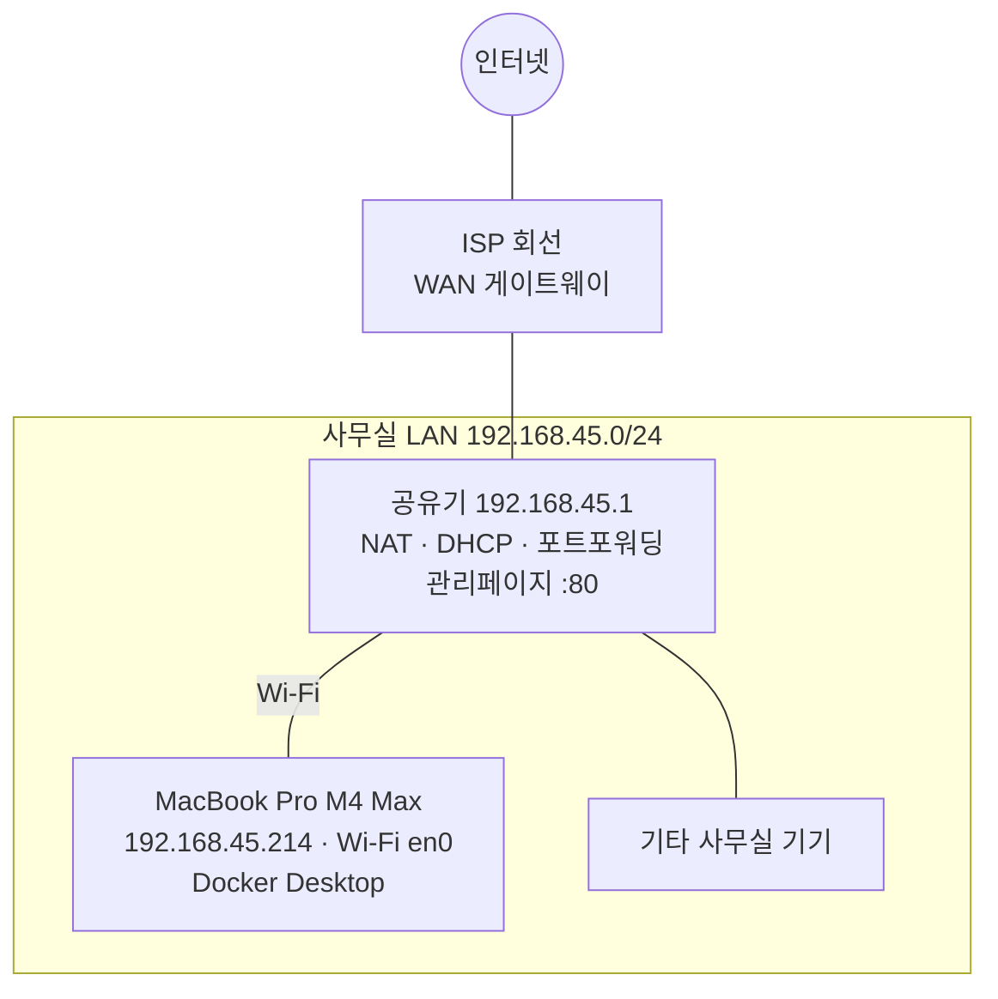

# 02. 사무실 네트워크 구성

> 이 저장소는 **public** 입니다. 실제 공인 IP / MAC 주소는 여기 적지 않고 `<PUBLIC_IP>`, `<MAC>` 으로 표기합니다.
> 실제 값은 개인 Obsidian 노트(`클라우드하모니/인프라 구성/02 사무실 네트워크`)에 있습니다.

## 토폴로지



## 현재 값 (2026-10-24 측정)

| 항목 | 값 | 비고 |
|------|----|------|
| 서버 호스트 | MacBook Pro (Apple M4 Max, 48GB) | macOS 15.5 |
| 서버 LAN IP | `192.168.45.214` (DHCP) | **DHCP 고정 할당 필요** |
| 서브넷 | `192.168.45.0/24` (255.255.255.0) | |
| 게이트웨이 / 공유기 | `192.168.45.1` | 관리 페이지가 **WAN 80 포트에서도 응답** 중 |
| DNS | ISP 제공 DNS 2개 | |
| 공인 IP | `<PUBLIC_IP>` (공유기 WAN 에 직접 할당) | 이중 NAT 아님 → 포트포워딩 1번이면 됨 |
| 공인 IP 성격 | 유동 IP 일 가능성 높음 | 바뀌면 접속 주소도 바뀜 → DDNS 권장 |
| DHCP 임대 | 6시간 | |
| macOS 방화벽 | 꺼짐 | |
| Docker Desktop | 포트 80 → nginx | 다른 프로젝트가 5432/5433/6333/8080 사용 중 (충돌 없음) |

## 외부 접근을 위한 공유기 설정 (수동 작업)

공인 IP 의 **80 포트는 공유기 관리 페이지가 사용 중**이라 그대로 포워딩할 수 없다. 두 가지 중 하나를 선택:

### 방법 A (권장) — 다른 외부 포트로 포워딩

| 외부 포트 | 내부 IP | 내부 포트 | 프로토콜 |
|-----------|---------|-----------|----------|
| `8888` (예시) | `192.168.45.214` | `80` | TCP |

→ 접속 주소: `http://<PUBLIC_IP>:8888/`

### 방법 B — 공유기 원격관리 포트를 옮기고 80 포워딩

공유기 관리 → 원격 관리 포트를 80 이외(또는 원격관리 **끄기**)로 변경 후 `80 → 192.168.45.214:80` 포워딩.
→ 접속 주소: `http://<PUBLIC_IP>/` (도메인 연결 시 가장 깔끔)

> 보안상 공유기 관리 페이지가 인터넷에 열려 있는 것 자체가 위험하므로, 어느 방법이든 **원격 관리는 끄는 것**을 권장.

### 함께 해야 할 설정

1. **DHCP 고정 할당**: Mac 의 MAC 주소 `<MAC>` → `192.168.45.214` 예약. 안 하면 IP 가 바뀌어 포워딩이 끊김.
2. **Mac 절전 방지**: 노트북이 잠들면 서비스도 내려감.
   ```bash
   sudo pmset -c sleep 0 disksleep 0   # 전원 연결 시 잠자기 끄기
   ```
   Docker Desktop → Settings → General → *Start Docker Desktop when you sign in* 체크.
3. **(가능하면) 유선 연결**: 현재 Wi-Fi. 서버 용도면 유선이 안정적.

### 검증

```bash
scripts/infra.sh check                     # 사무실 안: localhost / LAN 확인
curl http://<PUBLIC_IP>:8888/              # 사무실 밖(휴대폰 LTE 등)에서 확인
```

> 사무실 내부에서 공인 IP 로 접속하면 공유기의 NAT loopback(헤어핀) 지원 여부에 따라 실패할 수 있다. 외부 검증은 반드시 **사무실 밖 네트워크**에서.

## 도메인 구매 후

1. DNS A 레코드 → `<PUBLIC_IP>` (유동이면 Cloudflare DDNS 등)
2. `envs/office/terraform.tfvars` 의 `server_name = "도메인"`
3. TLS: 443 포워딩 + Let's Encrypt (certbot 컨테이너 or Cloudflare proxy) — `reverse-proxy` 모듈 확장 예정
4. 대안: **Cloudflare Tunnel** — 포트포워딩 없이 외부 공개 가능, 공인 IP 노출 없음
