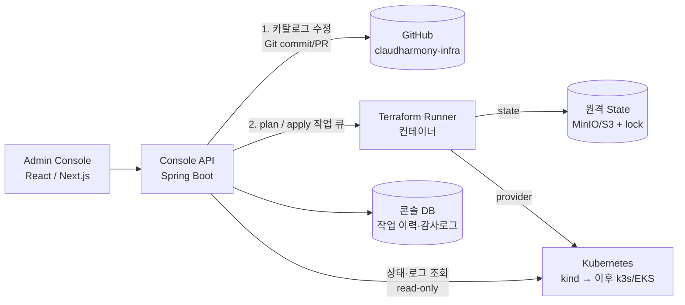

# 04. 어드민 콘솔 로드맵 — "우리만의 AWS/GCP 콘솔"

목표: 웹 콘솔에서 서비스 생성·배포·중지·삭제, 상태/로그 확인을 하고, 그 뒤에서는 **Terraform 이 실제 인프라를 관리**하는 구조.

## 핵심 원칙

1. **Terraform 이 단일 진실 원천(Source of Truth)** — 콘솔은 kubectl/Docker 로 직접 조작하지 않는다. 직접 조작하면 state 와 어긋난다(드리프트).
2. **콘솔은 데이터만 바꾼다** — HCL 은 사람이 리뷰하는 코드, 콘솔은 `services.auto.tfvars.json` (서비스 카탈로그)만 생성/수정.
3. **변경은 plan → 승인 → apply** — 클라우드 콘솔의 "검토 후 생성" 화면이 곧 `terraform plan` 결과.
4. **조회는 label 기반** — `claudharmony.managed-by=terraform`, `claudharmony.environment`, `claudharmony.service`.

## 이미 깔아둔 기반

| 기반 | 위치 | 콘솔에서의 용도 |
|------|------|-----------------|
| 서비스 카탈로그 JSON | `envs/<env>/services.auto.tfvars.json` | "서비스 생성" 폼 → JSON 수정 |
| 타입이 있는 변수 스키마 | `modules/k8s/env/variables.tf` 의 `services` | 폼 필드 / 검증 규칙의 근거 |
| 기계가 읽는 출력 | `terraform output -json services` | 서비스 목록 화면 |
| 리소스 label | 전 모듈 | 실시간 상태 (`kubectl get pods -l app.kubernetes.io/part-of=claudharmony`) |
| 모듈 = 클라우드 서비스 단위 | `modules/*` | 콘솔 메뉴 (VPC / Compute / Load Balancer) |
| 환경 디렉토리 | `envs/<env>` | 콘솔의 "프로젝트 / 리전" 선택 |

## 목표 아키텍처

## 단계별 계획

| 단계 | 내용 | 산출물 |
|------|------|--------|
| **0. 지금** | K8s + Terraform + JSON 카탈로그 + GitHub Actions 배포 (dev 자동 / prd 수동) | 이 저장소 |
| 1. Read-only 콘솔 | 서비스 목록/상태/로그 화면 (`output -json` + Kubernetes API 조회: Deployment/Pod/Event/로그) | `claudharmony-console` 저장소 → `envs/*/services` 에 등록해 K8s 에 배포 |
| 2. 원격 state | local → MinIO(S3 호환) backend + lock. 콘솔/사람이 같은 state 사용 | `envs/*/versions.tf` backend 변경 |
| 3. Runner | 콘솔 API 가 `terraform plan/apply` 를 작업 큐로 실행, 결과·로그 저장, 동시 실행 lock | `apps/tf-runner` |
| 4. Write 콘솔 | 서비스 생성/수정/삭제 폼 → JSON 변경 → plan 미리보기 → 승인 → apply | GitOps: 콘솔이 PR 생성 → merge 시 apply |
| 5. 인증·권한 | 로그인, 역할(Owner/Developer/Viewer), 감사 로그 | IAM 화면 |
| 6. 확장 | 도메인/TLS(cert-manager), 이미지 레지스트리(GHCR), 모니터링(Prometheus/Grafana), Argo CD(GitOps) | [K8s 학습 가이드](05-kubernetes-guide.md) |

## 콘솔 API 초안

| Method | Path | 동작 |
|--------|------|------|
| GET | `/api/envs` | 환경 목록 (`envs/*`) |
| GET | `/api/envs/{env}/services` | 카탈로그 + `output -json` + 실시간 상태 병합 |
| POST | `/api/envs/{env}/services` | 카탈로그에 추가 → plan 작업 생성 |
| PATCH/DELETE | `/api/envs/{env}/services/{name}` | 수정/삭제 → plan 작업 생성 |
| POST | `/api/runs/{id}/approve` | plan 승인 → apply |
| GET | `/api/runs/{id}` | 작업 상태 / plan·apply 로그 |
| GET | `/api/envs/{env}/services/{name}/logs` | 컨테이너 로그 스트림 (SSE) |

## 주의할 점

- Terraform 은 동시에 하나만 실행 — Runner 에서 환경별 lock 필수.
- 콘솔 서버가 클러스터 권한(ServiceAccount + RBAC)을 가지므로 최소 권한 Role 로 제한하고, 콘솔 자체를 외부에 열 때는 인증 + VPN/IP 제한.
- 콘솔 자체도 이 저장소의 서비스로 배포 (단, 자기 자신을 destroy 하지 못하게 보호).
