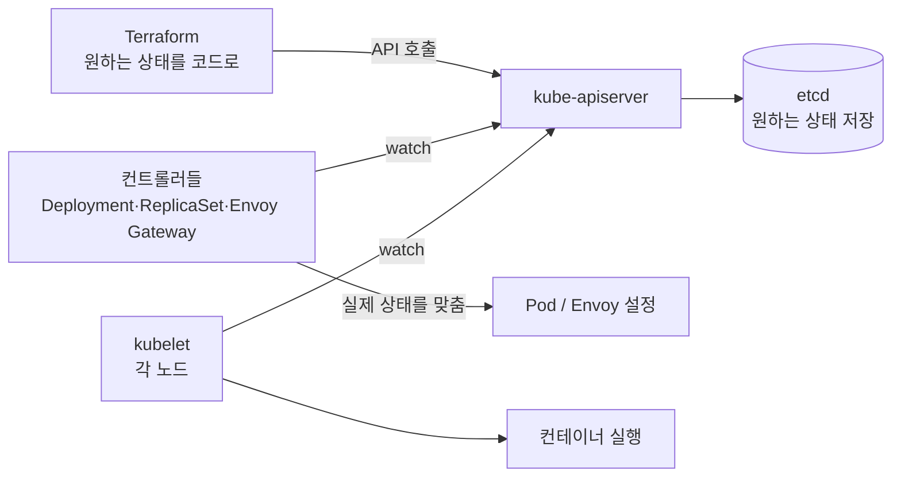
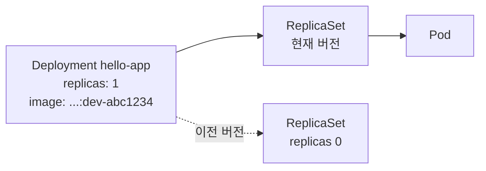
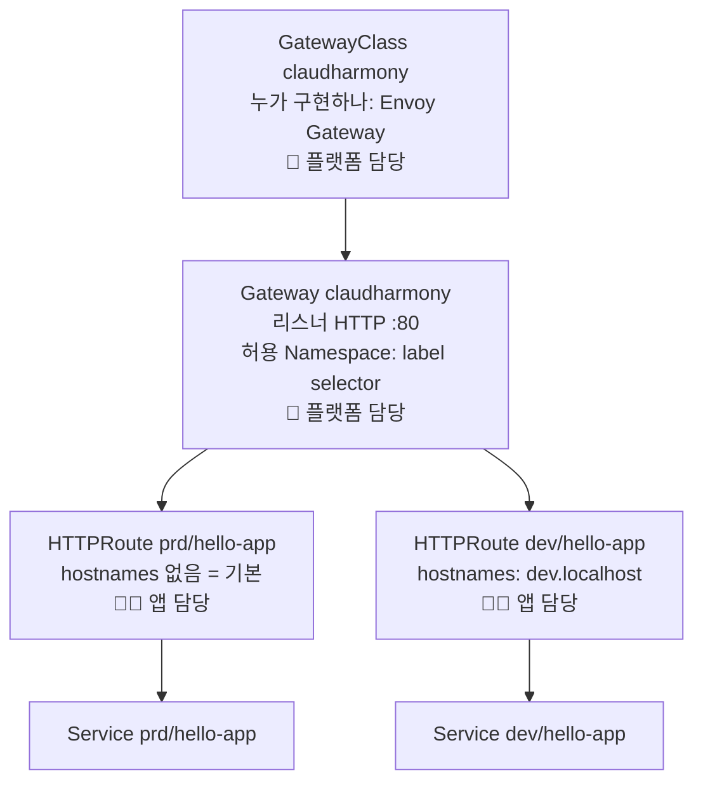

# 05. Kubernetes 학습 가이드

이 문서는 **우리 클러스터를 교재로** Kubernetes 를 익히기 위한 가이드다.
개념 → 우리 코드에서 어디에 있는지 → 직접 쳐볼 명령 순서로 정리했다.

```bash
export KUBECONFIG=~/.claudharmony/kubeconfig   # 먼저 실행
```

## 0. 큰 그림 — Terraform 과 Kubernetes 의 관계



- **Terraform**: "Deployment 를 이렇게 만들어라" 를 API 서버에 보낸다. (선언)
- **Kubernetes 컨트롤러**: 선언된 상태와 실제 상태의 차이를 계속 메운다. (조정 루프, reconcile)
- Pod 가 죽으면 Terraform 이 아니라 **Kubernetes 가** 다시 띄운다. Terraform 은 "선언"을 바꿀 때만 쓴다.

## 1. 클러스터와 노드

| 개념 | 설명 | 우리 코드 |
|------|------|-----------|
| Cluster | API 서버 + 노드들의 묶음 | `platform/cluster` |
| Node | Pod 가 실행되는 머신. kind 에서는 **Docker 컨테이너 하나 = 노드 하나** | `claudharmony-control-plane`, `claudharmony-worker` |
| control-plane | API 서버, etcd, 스케줄러, 컨트롤러 매니저가 도는 노드 | |
| worker | 앱 Pod 가 주로 도는 노드 | |

```bash
kubectl get nodes -o wide                    # 노드 2대, v1.37.0
docker ps --filter name=claudharmony         # 노드가 사실은 Docker 컨테이너
kubectl -n kube-system get pods              # 컨트롤플레인 구성요소들
kubectl api-resources | head -30             # 이 클러스터가 아는 리소스 종류
```

**해보기**: `docker exec -it claudharmony-worker crictl ps` — 노드 안에서 도는 실제 컨테이너 목록.

## 2. Namespace — 환경 경계

| 개념 | 설명 | 우리 코드 |
|------|------|-----------|
| Namespace | 리소스 이름 공간 + 권한/정책 경계. 같은 이름(`hello-app`)을 dev/prd 에 각각 둘 수 있다 | `modules/k8s/env/main.tf` 의 `kubernetes_namespace_v1` |
| Label | 키=값 태그. 선택(selector)의 기준 | `claudharmony.io/gateway-access=true` |

```bash
kubectl get ns --show-labels
kubectl -n dev get all
kubectl -n prd get all
```

## 3. Pod → ReplicaSet → Deployment — 앱 실행



| 개념 | 설명 | 우리 코드 |
|------|------|-----------|
| Pod | 컨테이너 1개 이상 + IP 1개. 언제든 죽고 새로 생길 수 있는 **일회용** | |
| ReplicaSet | "이 Pod 를 N개 유지" | (Deployment 가 자동 생성) |
| Deployment | 버전 관리 + **롤링 업데이트** 담당 | `modules/k8s/app/main.tf` |
| RollingUpdate | `max_surge=1, max_unavailable=0` → 새 Pod 가 Ready 된 뒤 옛 Pod 종료 = **무중단 배포** | 같은 파일 |
| resources | `requests` = 스케줄링 시 예약량, `limits` = 상한 (메모리 넘으면 OOMKilled) | `memory_mb` |

```bash
kubectl -n dev get deploy,rs,pod
kubectl -n dev describe deploy hello-app          # 이벤트, 전략, 이미지
kubectl -n dev rollout history deploy/hello-app   # 배포 이력 (ReplicaSet 별)
kubectl -n dev get pod -o jsonpath='{.items[0].spec.nodeName}'   # 어느 노드에 떴나
```

**해보기 (자가 치유)**:
```bash
kubectl -n dev delete pod -l app.kubernetes.io/name=hello-app
kubectl -n dev get pod -w        # 바로 새 Pod 가 생긴다 (ReplicaSet 이 개수를 맞춤)
```

## 4. Probe — 살아있나 / 준비됐나

| Probe | 실패 시 | 우리 설정 |
|-------|---------|-----------|
| liveness | 컨테이너 **재시작** | `/actuator/health/liveness`, 30초 후부터 10초 간격 |
| readiness | Service 엔드포인트에서 **제외** (트래픽 안 받음) | `/actuator/health/readiness`, 5초 간격 |

Spring Boot 는 Kubernetes 안에서 실행되면(`KUBERNETES_SERVICE_HOST` 환경변수 감지) 이 두 경로를 자동으로 연다.

```bash
kubectl -n dev describe pod -l app.kubernetes.io/name=hello-app | grep -A3 -E 'Liveness|Readiness'
kubectl -n dev get endpointslices        # readiness 통과한 Pod IP 만 들어 있다
```

## 5. Service — 고정된 내부 주소

Pod IP 는 바뀐다. **Service** 는 라벨 selector 로 Pod 들을 찾아 고정 IP·DNS 를 준다.

| 종류 | 설명 | 우리 사용 |
|------|------|-----------|
| ClusterIP | 클러스터 내부 전용 | `hello-app` (dev/prd) |
| NodePort | 모든 노드의 포트(30000~32767)로 노출 | `claudharmony-gateway` (30080) |
| LoadBalancer | 클라우드 LB 생성 | kind 에는 없음 → NodePort 로 대체 |

DNS 이름: `<service>.<namespace>.svc.cluster.local` → `hello-app.dev.svc.cluster.local`

```bash
kubectl -n dev get svc hello-app -o wide
kubectl run tmp --rm -it --image=curlimages/curl -n dev --restart=Never -- \
  curl -s http://hello-app.dev.svc.cluster.local/version
kubectl run tmp --rm -it --image=curlimages/curl -n dev --restart=Never -- \
  curl -s http://hello-app.prd.svc.cluster.local/version    # 다른 Namespace 도 DNS 로 접근 가능
```

> Namespace 간 통신 차단은 **NetworkPolicy** 로 한다 (아직 미적용 — 다음 학습 과제).

## 6. Gateway API — 외부 트래픽을 안으로



| 리소스 | 역할 | 우리 코드 |
|--------|------|-----------|
| GatewayClass | 어떤 컨트롤러가 Gateway 를 구현하는지 (Envoy Gateway) | `platform/gateway/main.tf` ③ |
| EnvoyProxy | Envoy Gateway 전용 설정 — Envoy 를 NodePort 30080 으로 | 같은 파일 ② |
| Gateway | 실제 로드밸런서 + 리스너. Envoy Pod 가 생긴다 | 같은 파일 ④ |
| HTTPRoute | Host/경로 → Service 규칙. **앱 Namespace 에 있다** | `modules/k8s/app/main.tf` |

라우팅 규칙:
- `/actuator...` → `/` 로 302 리다이렉트 (외부 비공개)
- `/` (PathPrefix) → Service `hello-app:80` → Pod `:8080`
- 여러 규칙이 맞으면 **더 긴 경로**가 이긴다

```bash
kubectl get gatewayclass,gateway -A
kubectl get httproute -A
kubectl -n dev describe httproute hello-app      # Status.Parents.Conditions: Accepted / ResolvedRefs
kubectl -n envoy-gateway-system get pods          # envoy-...: 실제 트래픽 처리, envoy-gateway: 컨트롤러
curl -s http://localhost/version                  # prd
curl -s http://dev.localhost/version              # dev
curl -s -H 'Host: dev.localhost' http://192.168.45.214/version   # LAN 에서 dev
```

**해보기**: `envs/dev/services.auto.tfvars.json` 에서 `route_path` 를 `/hello` 로 바꾸고 `scripts/infra.sh dev plan` → 어떤 리소스가 바뀌는지 보기 (apply 는 하지 말고 되돌리기).

## 7. 터널 — 클러스터에서 바깥으로

각 Namespace 의 `tunnel` Deployment(cloudflared)가 **Cloudflare 로 아웃바운드 연결**을 열고,
받은 요청을 `claudharmony-gateway.envoy-gateway-system.svc.cluster.local:80` 으로 보낸다.
dev 는 `--http-host-header dev.localhost` 로 Host 를 바꿔 dev 라우트에 매칭되게 한다.

```bash
kubectl -n prd logs deploy/tunnel | grep -E 'trycloudflare|Registered'
```

## 8. kind 특유의 것들

| 항목 | kind | 실제 클라우드 (EKS/GKE) |
|------|------|-------------------------|
| 노드 | Docker 컨테이너 | VM |
| LoadBalancer Service | 없음 → NodePort + `extraPortMappings` | 클라우드 LB 자동 생성 |
| 이미지 | `kind load docker-image` 로 노드에 직접 주입 | 레지스트리(ECR/GAR)에서 pull |
| 업그레이드 | 클러스터 재생성 | 노드그룹 롤링 업그레이드 |
| 스토리지 | `local-path` (노드 디스크) | EBS/PD |

### 트러블슈팅에서 배운 것: externalTrafficPolicy

처음 구성 때 `http://localhost/` 가 응답이 없었다. 노드 안에서 `curl 127.0.0.1:30080` 은 200 이었다.

- 호스트 :80 은 **control-plane 노드**의 30080 에만 연결돼 있다 (kind `extraPortMappings`).
- Envoy Pod 는 **worker 노드**에 떠 있다.
- Envoy Gateway 의 Service 기본값 `externalTrafficPolicy: Local` = "이 노드에 Pod 가 있을 때만 받는다" → control-plane 으로 들어온 외부 트래픽이 **버려짐**.
- `Cluster` 로 바꾸면 kube-proxy 가 다른 노드의 Pod 로 전달한다. (대가: 클라이언트 원본 IP 가 SNAT 으로 가려짐)

## 9. 다음 학습 과제 (순서 추천)

| # | 주제 | 해볼 것 |
|---|------|---------|
| 1 | ConfigMap / Secret | 앱 설정을 env 대신 ConfigMap 으로, DB 비밀번호를 Secret 으로 |
| 2 | HPA | `replicas` 대신 CPU 기반 자동 확장 (metrics-server 설치 필요) |
| 3 | NetworkPolicy | dev ↔ prd Namespace 간 통신 차단 |
| 4 | PodDisruptionBudget / anti-affinity | replicas 2 이상일 때 노드별 분산 |
| 5 | 모니터링 | kube-prometheus-stack (Prometheus + Grafana) 를 `platform/` 3번째 스택으로 |
| 6 | 레지스트리 | GHCR 로 이미지 push/pull — kind load 제거 |
| 7 | TLS | 도메인 구매 후 cert-manager + Gateway HTTPS 리스너 |
| 8 | GitOps | Argo CD 로 "Git = 클러스터 상태" — 어드민 콘솔과 비교해보기 |
| 9 | 실서버 | k3s (사무실 미니PC) 또는 EKS/GKE 로 `platform/cluster` 만 교체 |
