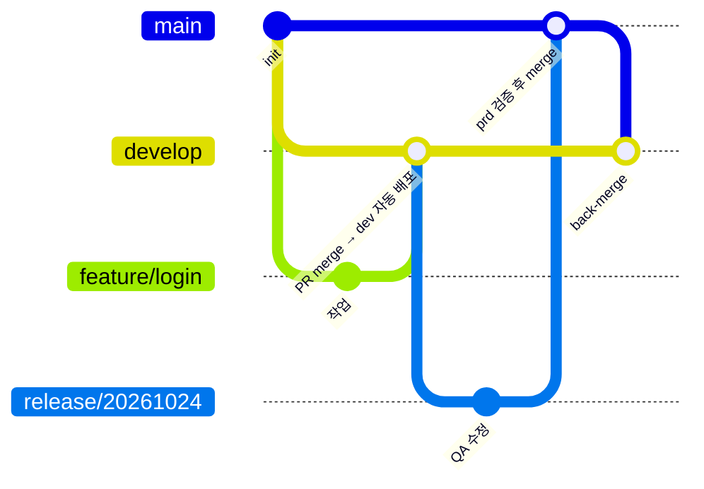
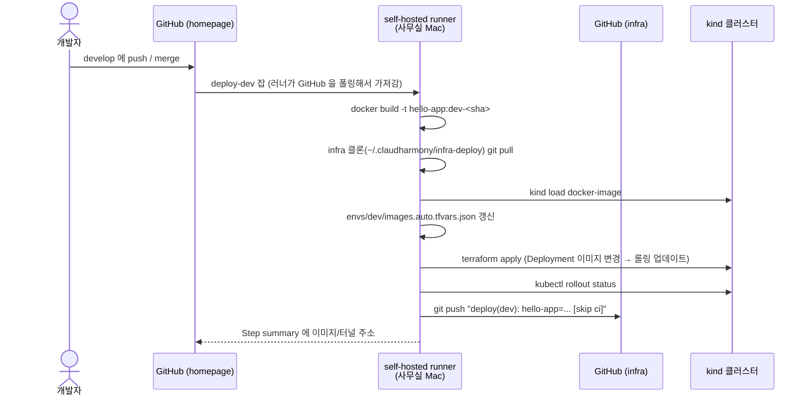

# 06. CI/CD — 브랜치 전략과 배포

## 저장소

| 저장소 | 공개 | 내용 | 기본 브랜치 |
|--------|------|------|-------------|
| [claudharmony-web](https://github.com/ParkSeWoo/claudharmony-web) | private | 프론트 — SvelteKit 3 (Node 24), 외부 `/` | `main`* |
| [claudharmony-api](https://github.com/ParkSeWoo/claudharmony-api) | private | 백엔드 — Spring Boot 4.1.2 / Java 25, 내부 전용 | `main`* |
| [claudharmony-homepage](https://github.com/ParkSeWoo/claudharmony-homepage) | private | (구) hello-app — **dev/prd 에서 제거됨**, archive 예정 | `develop` |
| [claudharmony-infra](https://github.com/ParkSeWoo/claudharmony-infra) | public | Terraform (클러스터/게이트웨이/환경), 배포 기록, 문서 | `main` |

\* web/api 는 2026-10-24 현재 `main` 만 push 된 상태 — `develop` push 부터 dev 배포가 시작된다.

## 앱 브랜치 전략



| 브랜치 | 용도 | 배포 |
|--------|------|------|
| `feature/*` | 기능 개발 | PR 시 CI 빌드 검증만 |
| `develop` | 통합 | **push/merge 하면 dev 자동 배포** |
| `release/YYYYMMDD` | 운영 배포 후보 | **Actions 에서 "Deploy prd" 수동 실행 → prd** |
| `main` | 운영에 나간 코드 | prd 검증 끝난 release 를 merge (배포 트리거 없음) |

### 운영 배포 절차

> DB 스키마 변경이 있는 릴리스는 **`DB schema prd`(계획 → `apply prd`) 를 먼저** 실행. 안 하면 `Deploy prd` 가 `check` 에서 멈춘다.

```bash
cd ~/workspace/claudharmony-homepage
git checkout develop && git pull
git checkout -b release/20261024 && git push -u origin release/20261024

# GitHub → claudharmony-homepage → Actions → "Deploy prd" → Run workflow
#   → Branch: release/20261024 → Run
# (CLI: gh workflow run deploy-prd.yml --ref release/20261024)

# 운영 확인 (curl http://localhost/version, 터널 주소) 후
gh pr create --base main --head release/20261024 --title "release/20261024"
gh pr merge --merge
git checkout develop && git merge origin/main && git push      # back-merge
```

`release/*` 가 아닌 브랜치에서 "Deploy prd" 를 실행하면 `reject` 잡이 실패시킨다.

## 앱 ↔ 인프라 계약

모든 서비스 공통 — 지키면 인프라 변경 없이 배포된다. 바꿔야 하면 infra 도 함께 수정.

| # | 조건 | 인프라 쪽 위치 |
|---|------|----------------|
| 1 | 루트 `Dockerfile` 로 빌드, 빌드 인자 `APP_VERSION` | 앱 워크플로 `docker build` |
| 2 | `/actuator/health/liveness`, `/actuator/health/readiness` 200 (**Node 앱도 같은 경로**) | `modules/k8s/app` probe |
| 3 | `/actuator/**` 는 외부 비공개 (Gateway 에서 `/` 로 리다이렉트) | `modules/k8s/app` HTTPRoute |
| 4 | `GET /version` → `{env, version}` (외부 노출 서비스) | 배포 확인 |
| 5 | 워크플로는 `shell: bash`(pipefail) + 배포 전 infra 클론 `pull --ff-only` | 앱 `.github/workflows/deploy-*.yml` |
| 6 | 서비스 이름 = 카탈로그 key = Deployment/Service 이름 = 내부 DNS | `envs/*/services.auto.tfvars.json` |
| 7 | `"database": true` 면 `SPRING_DATASOURCE_URL/USERNAME/PASSWORD` 주입 (PostgreSQL `pg-rw`). **스키마는 `db/schema.sql`(Atlas)** — 앱은 스키마를 바꾸지 않음, prd 는 `DB schema prd` → `Deploy prd` 순서 | [데이터베이스](09-database.md) |

### 서비스 카탈로그 (dev / prd 동일)

| 서비스 | 이미지 | 포트 | 외부 경로 | 메모리 | 저장소 |
|--------|--------|------|-----------|--------|--------|
| `web` | `claudharmony/web` | 3000 | `/` | 256Mi | claudharmony-web |
| `api` | `claudharmony/api` | 8080 | — (내부 전용, `http://api`) | 512Mi | claudharmony-api · `database=true` (**Atlas `db/schema.sql`**) |


- **web → api** 는 SSR 서버 간 호출: 같은 Namespace 의 Service `api` (포트 80 → 8080) — `http://api`
- 2026-10-24 hello-app → web 전환 완료 (dev, prd). 같은 경로가 겹치면 **먼저 생성된 HTTPRoute 가 우선**이라, 새 서비스를 띄워 검증한 뒤 옛 서비스를 카탈로그에서 빼는 방식으로 무중단 전환했다

### 동시 배포

여러 저장소의 러너가 같은 infra 클론과 Terraform state 를 쓰므로 `deploy.sh` 가 `~/.claudharmony/deploy.lock` (mkdir 잠금)으로 **한 번에 하나씩** 처리하고, `terraform` 은 `-lock-timeout=10m` 으로 state 잠금을 기다린다.

## 이미지 태그 규칙

| 환경 | 태그 | 예 |
|------|------|----|
| dev | `dev-<커밋 7자리>` | `claudharmony/hello-app:dev-1a2b3c4` |
| prd | `<release 날짜>-<커밋 7자리>` | `claudharmony/hello-app:20261024-1a2b3c4` |

`GET /version` 이 `{"env":"prd","version":"20261024-1a2b3c4"}` 처럼 현재 배포를 알려준다.

## 배포 파이프라인 (앱)



- **왜 self-hosted runner?** 사무실은 이중 NAT 라 GitHub 이 사무실로 접속할 수 없다. 러너가 **바깥으로** GitHub 에 붙어서 일을 가져가므로 포트포워딩이 필요 없다.
- **왜 배포 기록을 infra 에 커밋?** "지금 prd 에 뭐가 떠 있나" 가 Git 에 남고, 롤백은 그 파일을 이전 커밋으로 되돌리면 된다.

## 인프라 파이프라인

`claudharmony-infra` 의 `main` 에 push(머지)되면 **바뀐 스택을 자동 적용**한다.

| 변경 경로 | 자동 적용 | 비고 |
|-----------|-----------|------|
| `platform/gateway/**` | gateway | |
| `modules/k8s/**`, `envs/dev/**` | dev | gateway 다음 순서로 |
| `envs/prd/**` | ❌ 수동 | Actions → Infra apply → Run workflow → `prd` |
| `platform/cluster/**` | ❌ 수동 | kind 는 재생성 — gateway/dev/prd 도 다시 적용해야 함 |

- prd 인프라 변경은 수동 실행하거나, **다음 prd 앱 배포 때** 함께 적용된다 (`deploy.sh` 가 환경 전체를 apply).
- 배포 기록 커밋(`[skip ci]`)은 이 워크플로를 다시 돌리지 않는다.

## Self-hosted runner

| 항목 | 값 |
|------|----|
| 위치 | `~/.claudharmony/runners/<repo>/` (저장소당 1개) |
| 이름 | `office-mac-<repo>` (infra, homepage, api, web) |
| 라벨 | `self-hosted`, `claudharmony-office` |
| 실행 방식 | launchd 서비스 (`svc.sh`) — 로그인 시 자동 시작 |
| 등록 | `scripts/setup-runner.sh [repo ...]` (인자 없으면 infra, homepage) |

```bash
cd ~/.claudharmony/runners/claudharmony-homepage && ./svc.sh status
gh api repos/ParkSeWoo/claudharmony-homepage/actions/runners --jq '.runners[] | "\(.name) \(.status)"'
```

### 보안

- `claudharmony-infra` 는 **public** 이다. 외부인의 포크 PR 이 이 Mac 에서 코드를 실행하지 못하도록
  **"모든 외부 기여자 워크플로는 승인 필요"** 로 설정했다 (`fork-pr-contributor-approval = all_external_contributors`).
- 워크플로 트리거는 `push`(main) 와 `workflow_dispatch` 만 사용 — `pull_request` 로 self-hosted 러너를 쓰지 않는다.
- 더 안전하게 하려면 infra 저장소를 private 으로 전환 (권장).

## 필요한 GitHub 권한

| 무엇 | 왜 |
|------|----|
| gh 토큰 `workflow` scope | `.github/workflows/*` 파일 push (2026-10-24 `gh auth refresh -s workflow` 로 추가) |
| 러너 계정(이 Mac 의 gh 로그인)이 infra 저장소 push 권한 | 배포 기록 커밋 |
