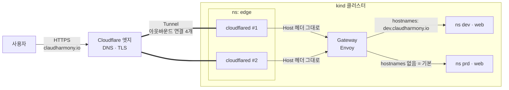

# 08. 도메인 연결 — claudharmony.io + Cloudflare Tunnel

> 민감 정보(API 토큰, Account ID, Tunnel ID/토큰)는 이 문서에 적지 않는다.
> 토큰은 저장소 밖 `~/.claudharmony/cloudflare.env` (chmod 600) 에만 있다.

## 결과

| 주소 | 환경 | 비고 |
|------|------|------|
| https://claudharmony.io | prd | |
| https://www.claudharmony.io | prd | |
| https://dev.claudharmony.io | dev | |
| http://localhost/ , http://dev.localhost/ | prd / dev | 사무실 Mac 에서 |

- **주소 고정** — 재시작/재배포해도 안 바뀐다 (임시 `*.trycloudflare.com` 은 제거)
- **HTTPS 자동** — Cloudflare 엣지에서 종단 (인증서 자동 발급·갱신)
- **포트포워딩 불필요** — 이중 NAT 그대로. 클러스터 안 cloudflared 가 **바깥으로** 연결
- **이중화** — cloudflared 커넥터 2개, 각 2개 연결 → 서울 엣지(ICN) 총 4개 연결

## 구조



- 터널은 **모든 호스트를 Gateway 하나로** 보낸다. 환경(dev/prd) 구분은 Gateway 의 **HTTPRoute hostnames** 가 한다.
  → 새 서브도메인을 추가할 때 터널은 호스트 이름만 추가하면 되고, 라우팅 규칙은 K8s 쪽에 있다.

## Terraform 구성 — `platform/edge` (2.5단계)

| 리소스 | 역할 |
|--------|------|
| `cloudflare_zero_trust_tunnel_cloudflared` | 터널 객체 (`config_src = "cloudflare"` → 라우팅 설정을 Cloudflare 가 보관) |
| `cloudflare_zero_trust_tunnel_cloudflared_config` | ingress 규칙: 각 호스트 → `http://claudharmony-gateway.envoy-gateway-system.svc.cluster.local:80`, 마지막은 `http_status:404` |
| `cloudflare_dns_record` × 3 | `CNAME <tunnel-id>.cfargotunnel.com`, `proxied = true` |
| `data.cloudflare_zero_trust_tunnel_cloudflared_token` | 커넥터 실행 토큰 |
| `kubernetes_secret_v1` | 토큰 → Secret `edge/cloudflared-token` |
| `kubernetes_deployment_v1` | cloudflared × 2 (`tunnel run`, `TUNNEL_TOKEN`), `/ready` probe |

```bash
scripts/infra.sh edge plan
scripts/infra.sh edge apply      # ~/.claudharmony/cloudflare.env 를 읽어 CLOUDFLARE_API_TOKEN, TF_VAR_cloudflare_account_id 설정
scripts/infra.sh edge status
scripts/infra.sh prd check       # local + https://claudharmony.io
```

서브도메인 추가: `platform/edge/variables.tf` 의 `hostnames` 에 추가 → `edge apply` → 해당 환경 HTTPRoute hostnames 에도 추가.

## 처음부터 설정하는 순서

### 1. 도메인 구매 — Cloudflare Registrar
- dash.cloudflare.com → **Domain Registration → Register Domains** → 검색 → 구매
- 원가 판매(갱신가 동일), WHOIS 비공개 기본, 네임서버 자동 설정
- `.kr` 은 미지원 → 국내 등록업체 구매 후 네임서버를 Cloudflare 로 변경

### 2. Zero Trust 활성화 (터널 사용 전 필수)
- https://one.dash.cloudflare.com → 팀 이름 지정 → **Free** 플랜 (결제수단 등록 요구될 수 있음, 과금 없음)
- 안 하면 API 로 터널 생성 시 `10000 Authentication error`, Access 조회 시 `access.api.error.not_enabled`

### 3. API 토큰 (계정 API 토큰, 최소 권한)
대시보드 → 계정 관리 → **계정 API 토큰 → 토큰 생성 → 처음부터 시작(Custom)**

| 정책 | 리소스 | 권한 |
|------|--------|------|
| 1 | 전체 계정 | **Cloudflare One Connector: cloudflared — Edit** |
| | | Cloudflare One Connectors — Edit |
| | | Argo Tunnel (Legacy) — Edit |
| | | Access: Apps and Policies — Edit (dev 접근 제한용, 선택) |
| 2 | 영역 `claudharmony.io` | **DNS — Edit**, **Zone — Read** |

- 만료 1년, IP 필터링 없음 (사무실 공인 IP 가 바뀔 수 있음)
- `Zone — Read` 는 Terraform 이 도메인 이름으로 zone 을 찾을 때 필요

### 4. 자격증명 파일 (저장소 밖)
```bash
# ~/.claudharmony/cloudflare.env  (chmod 600)
CLOUDFLARE_API_TOKEN=<토큰>
CLOUDFLARE_ACCOUNT_ID=<32자리 — 대시보드 URL dash.cloudflare.com/<여기>/...>
```

### 5. 적용
```bash
scripts/infra.sh edge apply
scripts/infra.sh dev apply   # dev HTTPRoute 에 dev.claudharmony.io 추가
```

## 트러블슈팅 (실제로 겪은 것)

| 증상 | 원인 | 해결 |
|------|------|------|
| 터널 생성 `10000 Authentication error`, 목록 조회는 성공 | 토큰에 터널 **쓰기** 권한 없음. UI 에서 "Cloudflare Tunnel" 로 검색하면 **Argo Tunnel (Legacy)** 만 나오는데 그것만으론 부족 | **Cloudflare One Connector: cloudflared — Edit** 추가 |
| 위와 동시에 `access.api.error.not_enabled` | 계정에 Zero Trust 미개설 | one.dash.cloudflare.com 에서 Free 플랜 활성화 |
| 권한을 넣었는데도 같은 오류 | 정책 카운터가 `0/72` — 체크가 저장 안 됨 | 정책 화면 카운터 확인 후 **토큰 업데이트** 버튼까지 누르기 |
| DNS 권한 항목이 `Account DNS Settings` 로 보임 | 정책 범위가 "전체 계정" | 범위를 **영역 → claudharmony.io** 로 바꾸면 `DNS`, `Zone` 항목이 나옴 |
| 토큰 상태 확인 `/user/tokens/verify` 실패 | 계정 API 토큰은 경로가 다름 | `/accounts/<id>/tokens/verify` |

인증 문제인지 입력 문제인지 가르는 요령: **빈 body 로 POST** → `10000 Authentication error` 면 권한, `1030 ... missing field` 면 권한 통과.

## 보안 메모

- 토큰은 API 토큰 화면에서 언제든 회수(Roll/Delete) 가능 — 유출 의심 시 즉시 Roll 하고 파일 교체
- 터널 토큰은 K8s Secret 으로만 존재 (`kubectl -n edge get secret cloudflared-token`) — 커밋 금지
- 다음 단계 후보: **Cloudflare Access** 로 `dev.claudharmony.io` 를 이메일 로그인 뒤로 숨기기 (토큰에 권한 이미 포함)
