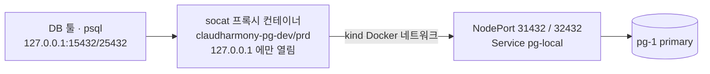

# 09. 데이터베이스 — PostgreSQL (CloudNativePG) 와 데이터 플랫폼 로드맵

## 원칙

| 위치 | 역할 |
|------|------|
| **애플리케이션 (api)** | 도메인 규칙·검증·트랜잭션 경계 |
| **PostgreSQL** | 저장·조회만. **저장 프로시저/트리거/DB 함수에 업무 규칙 넣지 않음** |
| **스키마** | api 저장소의 **`db/schema.sql` (Atlas 선언형)** — 앱은 스키마를 바꾸지 않는다 |
| **web** | DB 직접 접근 금지 — api 만 경유 |

DB 는 언제든 갈아끼울 수 있는 저장소로 둔다 → 나중에 RDS / Cloud SQL 이전 시 접속 정보만 교체.

## 지금 구성 (2026-10-24)

| 항목 | 값 |
|------|----|
| Operator | **CloudNativePG 1.30.1** (Helm chart 0.29.1) — `platform/database`, ns `cnpg-system` |
| 이미지 | `ghcr.io/cloudnative-pg/postgis:18.6-3.6.4-standard-trixie` — **PostgreSQL 18.6 + PostGIS 3.6.4** |
| 환경 | dev, prd 각 Namespace 에 Cluster `pg` (인스턴스 1, 스토리지 5Gi) |
| 메모리 | dev 384Mi / prd 512Mi (shared_buffers = 1/4) |
| 설정 | `timezone=Asia/Seoul`, `max_connections=50`, 0.5초 이상 쿼리 로그 |
| 확장 | `postgis` (initdb 시 생성) |
| 외부 공개 | **없음** — 클러스터 안 api 만 접근 |

### 만들어지는 것 (Namespace 마다)

| 종류 | 이름 | 용도 |
|------|------|------|
| Service | `pg-rw` | 읽기·쓰기 (primary) — **앱은 이것** |
| Service | `pg-ro` / `pg-r` | 읽기 전용 replica / 아무 인스턴스 (인스턴스 2개 이상일 때 의미) |
| Secret | `pg-app` | 앱 계정 `app` — `username`, `password`, `jdbc-uri`, `uri` … (CNPG 자동 생성) |
| Secret | `pg-readonly` | 조회 계정 `readonly` — Terraform 이 랜덤 생성, `pg_read_all_data` 역할 |
| PVC | `pg-1` | 데이터 (kind `standard` = local-path) |

### 계정

| 계정 | 권한 | 쓰는 곳 |
|------|------|---------|
| `app` | DB `claudharmony` 소유자 (읽기·쓰기·DDL) | api, Flyway |
| `readonly` | 모든 테이블 조회만 (`pg_read_all_data`), 연결 5개 제한 | DB 툴, 어드민 콘솔, 분석 |
| `postgres` | 슈퍼유저 | 운영자만 (`kubectl exec`) |

`readonly` 로 `CREATE TABLE` → `permission denied for schema public` 확인함.

## 앱에 연결하기

서비스 카탈로그에서 `"database": true` 인 서비스에 접속 정보가 자동 주입된다 (현재 `api`).

```json
"api": { "port": 8080, "database": true }
```

| 환경변수 | 값 |
|----------|----|
| `SPRING_DATASOURCE_URL` | `jdbc:postgresql://pg-rw.<env>.svc.cluster.local:5432/claudharmony` |
| `SPRING_DATASOURCE_USERNAME` | Secret `pg-app` → `username` |
| `SPRING_DATASOURCE_PASSWORD` | Secret `pg-app` → `password` |

api 에 `spring-boot-starter-data-jpa`(또는 jdbc) + `org.postgresql:postgresql` + `flyway-database-postgresql` 를 추가하면 바로 연결된다.
**의존성이 없으면 이 환경변수는 무시**된다.

2026-10-24 api 가 JPA 연결 완료 (api 세션, 처음엔 Flyway → 같은 날 Atlas 로 전환): dev 에 `V1 trend` 적용 → `trend_snapshot`, `trend_keyword` 테이블. 기동 직후 + 10분 주기로 Google 트렌드(KR) Top 10 을 시간당 1건 저장 → https://dev.claudharmony.io/trends

## 스키마 관리 — Atlas (선언형)

> 2026-10-24 Flyway → **Atlas** 로 전환. 이유: 운영에서 **앱 기동 시 자동 마이그레이션은 위험** (배포 = 스키마 변경, 실패 시 앱·DB 동시 꼬임).

"테이블이 이렇게 생겨야 한다"를 **`db/schema.sql` 한 파일**로 관리하고, Atlas 가 실제 DB 와 비교해 변경 SQL 을 **계산**한다 (Terraform 의 plan/apply 와 같은 감각).

| | dev | prd |
|---|---|---|
| 적용 시점 | `develop` push → `deploy-dev` 의 **DB schema 단계에서 자동** (앱 배포 전) | **`DB schema prd` 워크플로 수동 실행** (release/* 브랜치) |
| 안전장치 | — | ① 계획만 먼저 (confirm 비움) ② `confirm = "apply prd"` ③ 적용 직전 **pg_dump 백업** (`~/.claudharmony/backups/`) ④ 위험 변경(DROP·타입 변경)은 `allow_destructive` 필요 |
| 앱 배포 | 스키마 적용 뒤 | **`deploy-prd` 가 `check` — 적용 안 된 변경이 있으면 배포 중단** → "스키마 먼저, 앱 나중" 강제 |
| 앱의 역할 | 스키마 변경 안 함. api 는 JDBC(`JdbcClient`) — **기동 시 `information_schema` 로 필요한 테이블·컬럼 검증, 없으면 기동 실패** (JPA `validate` 와 같은 역할) | 동일 |

```bash
# 로컬에서
scripts/db-schema.sh dev plan  ~/workspace/claudharmony-api/db/schema.sql   # 실행될 SQL 미리보기
scripts/db-schema.sh dev apply ~/workspace/claudharmony-api/db/schema.sql
scripts/db-schema.sh prd plan  …                                            # prd 는 계획만 로컬에서, 적용은 워크플로로
```

동작: 로컬 Docker 에 빈 PostGIS DB(`claudharmony-atlas-dev`, `imresamu/postgis:18-3.6.1-trixie` — 공식 이미지는 arm64 없음)를 띄워 차이 계산용으로 쓰고, 대상 DB 는 port-forward + 앱 계정(소유자)으로 접속. Atlas `1.3.3-community` (오픈소스, 로그인 불필요).

| 변경 | 계획 결과 예 |
|------|-------------|
| 컬럼 추가 | `ALTER TABLE "trend_keyword" ADD COLUMN "region" character varying(20) NULL;` |
| 컬럼 삭제 | `ALTER TABLE ... DROP COLUMN ...` + **⚠️ 위험 변경 감지** |

규칙
- **뷰·트리거·프로시저 금지** (Community 판도 미지원 — "DB 에 업무 규칙 없음" 원칙과 일치)
- **하위 호환으로**: 새 컬럼은 NULL 허용으로 추가 → 앱 배포 → 필요하면 다음 릴리스에서 NOT NULL. 삭제는 코드에서 안 쓰게 한 다음 릴리스에서
- 제외 객체: `spatial_ref_sys`(PostGIS), `flyway_schema_history`(과거 이력 — dev 는 2026-10-24 삭제, prd 는 Flyway 없는 버전 배포 후 삭제)
- 테스트 DB(Testcontainers)도 `db/schema.sql` 로 생성 → **스키마 기준 파일 하나**

## 로컬에서 DB 확인하기 — `scripts/db.sh`

```bash
scripts/db.sh up            # 한 번만 — dev·prd 상시 연결 (재부팅 후에도 자동)
scripts/db.sh status        # 연결 상태
scripts/db.sh info          # 접속 정보 표 (비밀번호 가림 / --show 표시 / info dev app --copy 클립보드)
scripts/db.sh pgpass        # ~/.pgpass 생성 → psql·pg_dump 비밀번호 생략 (prd 쓰기 계정 제외)
scripts/db.sh psql dev      # 바로 SQL (기본 readonly) · psql dev app 은 쓰기 계정
scripts/db.sh down          # 연결 끊기
```

| 환경 | 호스트 | 포트 | DB | 계정 |
|------|--------|------|----|------|
| dev | `127.0.0.1` | **15432** | `claudharmony` | `readonly`(기본) / `app` |
| prd | `127.0.0.1` | **25432** | `claudharmony` | `readonly`(기본) / `app`(명시할 때만) |

SSL 은 끔 (Mac 안에서만 연결). 비밀번호는 `scripts/db.sh info --show` 또는 `--copy`.

### 동작 방식



- 처음엔 `kubectl port-forward` 였는데, **클라이언트가 접속을 끊을 때 DB 쪽 리셋으로 port-forward 프로세스 자체가 종료**(`lost connection to pod`)되는 한계 → DB 툴(연결을 자주 여닫음)에서 불안정
- 그래서 `modules/k8s/postgres` 에 **NodePort Service `pg-local`**(dev 31432, prd 32432) + Mac 의 **socat 프록시 컨테이너**(`alpine/socat:1.8.1.1`, `--restart unless-stopped`, 127.0.0.1 바인딩)
- NodePort 는 호스트 포트 매핑이 없어 **인터넷·사무실 LAN 에서는 닿지 않음** (같은 Mac 의 kind Docker 네트워크 안에서만)

### IntelliJ 에서 보기 (Database 도구)

1. `scripts/db.sh up` (한 번만)
2. 오른쪽 **Database** 탭 → **+ → Data Source → PostgreSQL** (드라이버 다운로드 승인)
3. 이름 `claudharmony dev`, Host `127.0.0.1`, Port `15432`, Database `claudharmony`, User `readonly`, Password = `scripts/db.sh info dev readonly --copy` 후 붙여넣기 → **Test Connection** → OK
4. prd 도 같은 방법으로 Port `25432` — **prd 는 readonly 만** 등록 권장. 데이터 소스 설정의 *Options → Read-only* 도 체크
5. 색 구분: 데이터 소스 우클릭 → *Color Settings* → prd 를 빨간색

### psql 자주 쓰는 것

```sql
\dt                      -- 테이블 목록
\d trend_keyword         -- 테이블 구조
select * from trend_snapshot order by collected_hour desc limit 5;
select postgis_version();
```

## 운영

```bash
scripts/infra.sh database status                       # Operator + 모든 Cluster
kubectl -n dev get cluster pg                          # STATUS: Cluster in healthy state
kubectl -n dev describe cluster pg                     # 이벤트
kubectl -n dev logs pg-1 -c postgres | tail            # PG 로그 (JSON)
kubectl top pods -n dev                                # 메모리
```

k9s: `:clusters.postgresql.cnpg.io` 또는 `:pods` 에서 `pg-1`.

### 스펙 변경

| 바꿀 것 | 위치 | 영향 |
|---------|------|------|
| 메모리·스토리지·인스턴스 수 | `envs/<env>/main.tf` 의 `database = { ... }` | Operator 가 롤링 적용. 스토리지는 늘리기만 가능 |
| PostgreSQL 마이너 버전 | `modules/k8s/postgres` 의 `image` | Operator 가 롤링 업데이트 |
| 확장 추가 | `extensions` (예: `postgis_topology`) | **initdb 때만 실행** → 기존 DB 는 `CREATE EXTENSION` 수동 또는 Flyway |

### ⚠️ 데이터 보존 — 아직 백업 없음

- PVC 는 kind 노드 컨테이너 안 디스크 → Pod/노드 재시작은 안전, **`cluster apply` 로 클러스터 재생성 시 데이터 소실**
- 다음 작업: CNPG **Barman Cloud Plugin** 으로 Cloudflare R2(또는 MinIO)에 base backup + WAL 아카이브 → 클러스터 재생성 시 `bootstrap.recovery` 로 복구

## 데이터 플랫폼 로드맵

앞으로 붙일 기능(위치 기반, 트렌드 크롤링, 기술 블로그 수집·알림, AI)에 맞춘 저장소 분리:

| 계층 | 저장소 | 데이터 | 단계 |
|------|--------|--------|------|
| 서비스 DB (OLTP) | **PostgreSQL + PostGIS** | 회원·게시글·설정·위치 원본 | ✅ 지금 |
| 백업 | R2 / MinIO (Barman Cloud) | base backup + WAL | 다음 |
| 캐시·실시간 | **Redis** | 캐시, GEO 주변 검색, 순위, Streams 큐 | 2 |
| 원본 저장소 | **오브젝트 스토리지** (MinIO → R2/S3) | 크롤링 원본(Bronze), Parquet | 2 |
| 워커 | 카탈로그에 CronJob / Worker 유형 | 크롤러, 수집기, 임베딩, 알림 | 3 |
| 벡터 DB | **Qdrant** (전용) | 글·트렌드·블로그 임베딩 | 3~4 |
| 분석 DB (OLAP) | **ClickHouse** | 전국 트렌드 (지역 × 연령 × 시간 × 키워드), 수억 건 | 4 |
| 수집 버퍼 | **Redpanda** (Kafka 호환) | 크롤러 → 정제 사이 이벤트 | 4 |
| 관측 | Prometheus + Grafana | 메트릭, 수집 실패 알림 | 5 |

```
크롤러(CronJob) ─원본→ 오브젝트 스토리지 (Bronze)
      └─이벤트→ Redpanda → 정제/집계 → ClickHouse (Silver/Gold)
                         └→ 임베딩 → Qdrant
api (도메인) ── PostgreSQL / Redis ── 서비스는 Gold 집계 + 벡터 검색 결과만 조회
```

선행 조건: **Docker Desktop 메모리 8GB → 16~20GB** (현재 사용 ~5.5GB), 대량 데이터용 디스크(Mac 폴더 extraMounts 또는 R2).
