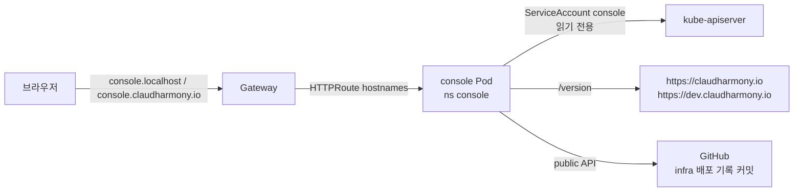

# 10. 관리자 콘솔 (claudharmony-console)

AWS/GCP 콘솔처럼 사무실 Kubernetes 인프라를 한 화면에서 보는 관리자 페이지.
저장소: [claudharmony-console](https://github.com/ParkSeWoo/claudharmony-console) (private) · 로컬 `~/workspace/claudharmony-console`

| 주소 | 상태 |
|------|------|
| http://console.localhost | ✅ 사무실 Mac |
| https://console.claudharmony.io | ⏳ Keycloak 로그인 적용 완료(2026-10-25). 관리자 첫 로그인 확인 후 `edge apply`로 DNS 공개 |

## 1단계 — 조회 전용 (2026-10-24)

| 화면 | 내용 |
|------|------|
| 대시보드 | 노드(Ready·버전·CPU/MEM), 플랫폼 구성요소(Gateway·도메인 터널·CNPG·Envoy Gateway·metrics-server), 외부 접속(응답코드·버전·지연), 환경 카드(prd/dev/console), 최근 배포 |
| 환경 상세 `/env/{ns}` | 서비스별 Pod·재시작·노드·CPU/MEM, PostgreSQL 상태, HTTPRoute(호스트·경로·Accepted), 최근 1시간 경고 이벤트 |
| 로그 `/env/{ns}/logs/{svc}` | 마지막 200줄(최대 2000), 새로고침 버튼으로 갱신 |

- 화면 갱신은 상단 **새로고침 버튼**으로만 (자동 갱신은 사용자 요청으로 보류). 배포 이력은 GitHub 비인증 API 2분 캐시
- 상태를 바꾸는 엔드포인트는 **없음**

## 로그인 — Keycloak (2026-10-25)

- 홈페이지와 같은 prd realm(`claudharmony`)의 client `console`로 로그인. **realm 역할 `admin`이 있는 사람만** 볼 수 있음 (그 외 403)
- 홈페이지에서 이미 로그인했다면 Keycloak 세션이 있어 콘솔은 다시 묻지 않고 열림 (SSO)
- 관리자 계정: prd realm `admin` (Terraform `platform/realms`, admin 역할). 임시 비밀번호 → 첫 로그인 때 변경
  ```bash
  kubectl -n identity get secret keycloak-service-admin -o jsonpath='{.data.password}' | base64 -d | pbcopy
  ```
- 앱 구현 (claudharmony-console `security/`):
  - Spring Security `oauth2Login`. client 등록은 **discovery 없이 직접** — 기동 때 인터넷 주소를 부르지 않아 터널 장애 때도 콘솔이 뜬다
  - 브라우저가 가는 주소(로그인·로그아웃)는 공개 주소, 토큰 교환·키·사용자 정보는 클러스터 안 주소. ID 토큰 `iss`는 공개 주소와 비교
  - 역할은 ID 토큰 `roles` claim (`platform/realms`의 `realm-roles` 매퍼) → `ROLE_admin`
  - 프로필 `keycloak`이 없으면 **모든 요청 거부** (fail-closed). 로컬에서만 `console.auth.local-dev=true`
- 인프라 연결: `envs/console/services.auto.tfvars.json` — `SPRING_PROFILES_ACTIVE=keycloak` + Secret `keycloak-console` 4개
- 공개 도메인은 HTTPRoute `console-public`에서 `X-Forwarded-Proto: https` 고정 → `{baseUrl}`이 https가 되어 redirect URI가 맞음

## 구조



| 항목 | 값 |
|------|----|
| 스택 | Java 25, Spring Boot 4.1.2, fabric8 kubernetes-client 7.9.0, Thymeleaf + htmx 2.0.11 |
| 코드 컨벤션 | **Google Java Style** — Spotless 8.9.0 + google-java-format 1.36.1 (`./gradlew spotlessApply`) |
| 배포 | `main` push → `deploy.yml` (self-hosted runner) → `deploy.sh console console <image>` |
| 인프라 | `envs/console` — Namespace `console`, 서비스 카탈로그 1개, `hostnames = [console.localhost, console.claudharmony.io]` |

## 권한 — 최소 권한

ClusterRole `claudharmony-console-read` + ServiceAccount `console` (`envs/console/main.tf`):

| API 그룹 | 리소스 | 동작 |
|----------|--------|------|
| core | namespaces, nodes, pods, pods/log, services, events, PVC, configmaps | get/list/watch |
| apps / batch | deployments, replicasets, statefulsets / jobs, cronjobs | get/list/watch |
| gateway.networking.k8s.io | gateways, httproutes, gatewayclasses | get/list/watch |
| postgresql.cnpg.io | clusters, backups, scheduledbackups | get/list/watch |
| metrics.k8s.io | pods, nodes | get/list |

**Secret 은 권한에 없음** — DB 비밀번호·터널 토큰을 콘솔이 읽을 수 없다. 화면에서 볼 수 있는 Namespace 도 설정(`console.environments`)으로 제한.

## 공개 주소 보호 — Cloudflare Access

`console.claudharmony.io` 는 Cloudflare 엣지에서 **이메일 일회용 코드 로그인**을 통과해야 터널에 닿게 한다 (`platform/edge`).
허용 이메일은 공개 저장소에 두지 않고 `~/.claudharmony/cloudflare.env` 의 `CONSOLE_ALLOWED_EMAILS` 로 주입.

⚠️ 2026-10-24 첫 시도: 토큰에 Access 쓰기 권한이 없어 **DNS 는 생기고 Access 는 실패** → 1분여 보호 없이 열림(콘솔 미배포 상태라 공개 홈페이지만 보임) → 즉시 DNS 제거.
재적용 시 **Access 리소스가 성공한 뒤에 DNS 를 만들도록 의존성(`depends_on`)** 을 건다.

## 로드맵

| 단계 | 기능 | 방식 |
|------|------|------|
| 1 ✅ | 조회 | K8s API 읽기 |
| 2 | 시작/중지 | 카탈로그 `replicas` 0↔N → infra 저장소 커밋 → Infra apply (GitHub App/토큰) |
| 2 | 재시작 | `rollout restart` (권한: deployments patch) |
| 2 | prd 배포 / 롤백 | 앱 저장소 `deploy-prd` 워크플로 실행 / images 기록 되돌리기 커밋 |
| 3 | 서비스 추가, DB 생성, 크롤러 주기 | 카탈로그 폼 → 커밋 |
| 3 | 감사 로그, 권한 | Access 사용자 → 동작 기록 |
