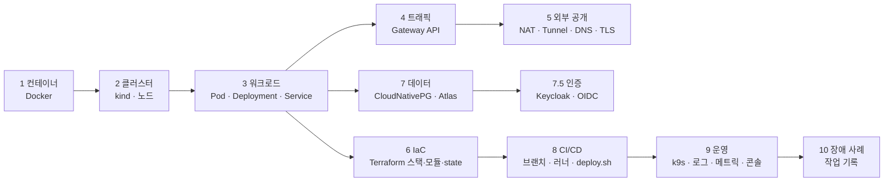

# 11. 학습 가이드 — 이 인프라를 바닥부터 이해하기

이 문서는 **우리 인프라를 교재로** 순서대로 따라가는 커리큘럼이다.
각 단계는 **① 개념 → ② 우리 구성(파일 위치) → ③ 직접 확인 → ④ 실습 → ⑤ 체크리스트** 로 되어 있다.
전체 그림은 [아키텍처](01-architecture.md), K8s 개념 상세는 [Kubernetes 학습 가이드](05-kubernetes-guide.md).

```bash
# 시작 전 — 모든 단계에서 쓰는 준비
export KUBECONFIG=~/.claudharmony/kubeconfig   # (~/.zshrc 에 이미 설정됨)
cd ~/infra
```

> ⚠️ 실습은 **dev 또는 읽기 전용 명령**만. prd 를 바꾸는 명령은 이 문서에 없다.

## 학습 지도



| 단계 | 주제 | 예상 시간 |
|------|------|-----------|
| 1 | 컨테이너 | 30분 |
| 2 | 클러스터와 노드 | 30분 |
| 3 | 워크로드 (Pod/Deployment/Service) | 1시간 |
| 4 | 트래픽 (Gateway API) | 1시간 |
| 5 | 외부 공개 (이중 NAT, Tunnel, DNS, TLS) | 1시간 |
| 6 | Terraform 구조 | 1~2시간 |
| 7 | 데이터 (PostgreSQL Operator, Atlas) | 1시간 |
| 7.5 | 인증 (Keycloak, OIDC) | 1시간 |
| 8 | CI/CD | 1시간 |
| 9 | 운영 도구 | 30분 |
| 10 | 장애 사례 복기 | 1시간 |

---

## 1단계 — 컨테이너

**① 개념**: 이미지 = 실행 파일 묶음(불변), 컨테이너 = 이미지를 실행한 프로세스. 멀티스테이지 빌드로 "빌드 도구 이미지 → 실행용 작은 이미지".

**② 우리 구성**: 각 앱 저장소 루트 `Dockerfile` (예: `~/workspace/claudharmony-api/Dockerfile` — `temurin:25-jdk` 로 빌드 → `temurin:25-jre` 로 실행). 이미지 이름 `claudharmony/<서비스>:<태그>`.

**③ 확인**
```bash
docker images 'claudharmony/*' --format '{{.Repository}}:{{.Tag}}  {{.Size}}' | head
docker ps --filter name=claudharmony     # kind 노드도 사실은 컨테이너!
```

**④ 실습**: `docker history claudharmony/api:<태그>` 로 레이어 보기 → 어떤 레이어가 큰지 찾아보기.

**⑤ 체크**: □ 이미지와 컨테이너의 차이 □ 멀티스테이지 빌드의 이점 □ 태그 `dev-<sha>` / `20261024-<sha>` 의 의미

---

## 2단계 — 클러스터와 노드

**① 개념**: 클러스터 = API 서버(+etcd, 스케줄러, 컨트롤러) + 노드. 노드의 kubelet 이 컨테이너를 실행. kind 는 "노드 = Docker 컨테이너".

**② 우리 구성**: `platform/cluster/` — `kind-config.yaml.tftpl` (노드 2개, `extraPortMappings 30080 → 호스트 80`), `main.tf` (`terraform_data` + `kind create cluster`).

**③ 확인**
```bash
kubectl get nodes -o wide
kubectl -n kube-system get pods                  # API 서버, etcd, coredns …
docker port claudharmony-control-plane           # 30080/tcp -> 0.0.0.0:80
kubectl top nodes                                # metrics-server
```

**④ 실습**: `docker exec -it claudharmony-worker crictl ps` — 노드 안에서 실제로 도는 컨테이너 목록을 `kubectl get pods -A -o wide` 와 비교.

**⑤ 체크**: □ control-plane 과 worker 의 역할 □ 왜 kubeconfig 를 분리했는지(`kind-ch4` 보호) □ kind 업그레이드 = 재생성인 이유

---

## 3단계 — 워크로드 (Pod · Deployment · Service)

**① 개념**: Pod(일회용) ← ReplicaSet(개수 유지) ← Deployment(버전·롤링 업데이트). Service = Pod 앞의 고정 주소(DNS `이름.ns.svc.cluster.local`). Probe: liveness(재시작) / readiness(트래픽 제외).

**② 우리 구성**: `modules/k8s/app/main.tf` — Deployment(`RollingUpdate maxSurge 1 / maxUnavailable 0` = 무중단), Service(80 → 컨테이너 포트), probe(`/actuator/health/liveness|readiness`), 리소스(`memory_mb`). 어떤 서비스가 있는지는 `envs/<env>/services.auto.tfvars.json`.

**③ 확인**
```bash
kubectl -n dev get deploy,rs,pod,svc
kubectl -n dev describe deploy api | sed -n '/Containers/,/Conditions/p'
kubectl -n dev rollout history deploy/web
kubectl run t --rm -it --image=curlimages/curl -n dev --restart=Never -- curl -s http://api/actuator/health
```

**④ 실습 (dev)**: `kubectl -n dev delete pod -l app.kubernetes.io/name=web` → `kubectl -n dev get pod -w` 로 자가 치유 관찰 (새 Pod 가 바로 생김).

**⑤ 체크**: □ Pod 를 직접 지워도 되는 이유 □ readiness 실패 시 일어나는 일 □ `http://api` 가 같은 Namespace 의 Service 로 풀리는 원리

---

## 4단계 — 트래픽 (Gateway API)

**① 개념**: GatewayClass(어떤 구현체) → Gateway(리스너, 실제 LB) → HTTPRoute(호스트·경로 → Service). 인프라 담당과 앱 담당이 리소스로 분리됨. 경로가 겹치면 **오래된 라우트 우선**, 경로는 **긴 것 우선**.

**② 우리 구성**: `platform/gateway/main.tf` (Envoy Gateway Helm, `EnvoyProxy` = NodePort 30080 + `externalTrafficPolicy: Cluster`, Gateway 는 라벨 `claudharmony.io/gateway-access=true` Namespace 만 허용), `modules/k8s/app` 의 HTTPRoute (`/actuator` → `/` 리다이렉트 규칙 포함).

**③ 확인**
```bash
kubectl get gatewayclass,gateway -A
kubectl get httproute -A
kubectl -n dev describe httproute web | sed -n '/Status/,$p'    # Accepted / ResolvedRefs
curl -s http://localhost/version; curl -s http://dev.localhost/version
curl -s -H 'Host: dev.localhost' http://127.0.0.1/version       # Host 헤더로 환경이 갈림
```

**④ 실습**: `curl -sI http://localhost/actuator/env` → 302 확인 (외부 비공개 규칙). 왜 Pod 의 probe 는 영향이 없는지 설명해 보기.

**⑤ 체크**: □ prd 라우트에 hostnames 가 없는 이유 □ `externalTrafficPolicy: Local` 이면 왜 안 됐는지 ([작업 기록 #9](07-worklog.md)) □ 네임스페이스 라벨 selector 의 보안 의미

---

## 5단계 — 외부 공개 (이중 NAT · Tunnel · DNS · TLS)

**① 개념**: NAT 뒤 서버는 밖에서 못 들어온다 → 포트포워딩(인바운드) 또는 **터널(아웃바운드)**. Cloudflare Named Tunnel = 고정 이름 + 여러 커넥터. DNS CNAME → `<tunnel>.cfargotunnel.com`, `proxied` 레코드는 Cloudflare 가 TLS 종단. Access = 엣지에서 로그인.

**② 우리 구성**: [사무실 네트워크](02-office-network.md) (SK 공유기 → 상위 GNT2400 이중 NAT), `platform/edge/main.tf` (터널, ingress = 모든 호스트 → Gateway, DNS ×3, cloudflared ×2), [도메인 연결](08-domain.md).

**③ 확인**
```bash
kubectl -n edge get deploy,pods
kubectl -n edge logs deploy/cloudflared | grep -E 'Registered tunnel connection' | tail -4   # icn = 서울 엣지
dig +short cloudharmony.io                       # Cloudflare IP (사무실 IP 아님)
curl -sI https://cloudharmony.io | grep -i server
scripts/infra.sh prd check
```

**④ 실습**: `kubectl -n edge delete pod <cloudflared 하나>` → 그동안 `curl https://claudharmony.io/version` 이 계속 되는지 (커넥터 이중화).

**⑤ 체크**: □ 인바운드 vs 아웃바운드 연결 □ 공인 IP:80 에서 공유기 로그인 화면이 보였던 이유 □ Quick Tunnel 대신 Named Tunnel 로 바꾼 이유 □ "보호 먼저, 노출 나중" (콘솔 사고 — [작업 기록 #30](07-worklog.md))

---

## 6단계 — Terraform 구조

**① 개념**: 선언(원하는 상태) → `plan`(차이) → `apply`. state = Terraform 이 관리하는 실제 리소스 목록. 모듈 = 재사용 단위. provider = 대상 API(kubernetes, helm, cloudflare…).

**② 우리 구성**
```
platform/{cluster,gateway,edge,addons,database}   # 클러스터 공용 — 단계별 state
envs/{dev,prd,console}                             # 환경 — 카탈로그(JSON) + 배포 기록(JSON)
modules/k8s/{env,app,postgres,tunnel}             # 재사용 모듈
scripts/infra.sh <stack> <plan|apply|status|...>  # backend 경로·자격증명 주입
```
state 는 저장소 밖 `~/.claudharmony/state/<stack>.tfstate`.

**③ 확인**
```bash
scripts/infra.sh dev plan            # "No changes" = 코드와 실제가 일치
terraform -chdir=envs/dev state list
cat envs/dev/services.auto.tfvars.json envs/dev/images.auto.tfvars.json
```

**④ 실습 (plan 만)**: `envs/dev/services.auto.tfvars.json` 의 web `memory_mb` 를 바꿔 `scripts/infra.sh dev plan` → 어떤 리소스가 "update in-place" 인지 확인 → **되돌리기** (`git checkout envs/dev`).

**⑤ 체크**: □ 왜 스택을 나눴나(CRD 순서, 폭발 반경) □ HCL 대신 JSON 카탈로그를 둔 이유(콘솔) □ provider 가 기본값을 채워서 생기는 드리프트(`memory_swap` 사례)

---

## 7단계 — 데이터 (PostgreSQL Operator · Atlas)

**① 개념**: Operator = "운영 지식을 코드로 만든 컨트롤러". `Cluster` CR 하나로 PostgreSQL 생성·장애조치·업그레이드. 스키마는 **선언형**(최종 모습) → 도구가 ALTER 계산.

**② 우리 구성**: `platform/database` (CNPG Operator), `modules/k8s/postgres` (Cluster `pg`, 계정 `app`/`readonly`, PostGIS), api `db/schema.sql` + `scripts/db-schema.sh` (Atlas). 상세 [데이터베이스](09-database.md).

**③ 확인**
```bash
kubectl get clusters.postgresql.cnpg.io -A
kubectl -n dev exec pg-1 -c postgres -- psql -U postgres claudharmony -c '\dt'
scripts/db.sh up && scripts/db.sh psql dev   # 로컬 접속 (readonly) — IntelliJ 는 127.0.0.1:15432
scripts/db-schema.sh dev plan ~/workspace/claudharmony-api/db/schema.sql
```

**④ 실습 (plan 만)**: schema.sql 복사본에 컬럼을 하나 추가/삭제해서 `plan` → `ADD COLUMN` / ⚠️ 위험 변경 감지 보기.

**⑤ 체크**: □ 왜 앱 기동 시 자동 마이그레이션을 운영에서 금지했나 □ `DB schema prd` → `Deploy prd` 순서와 `check` □ readonly 계정이 쓰기를 못 하는 원리(`pg_read_all_data`) □ 아직 정기 백업이 없다는 위험

---

## 7.5단계 — 인증 (Keycloak · OIDC)

**① 개념**: 로그인을 앱마다 만들지 않고 **IdP**(Keycloak)에 맡긴다. 앱은 OIDC로 토큰을 받고, api는 토큰 서명(JWKS)·`iss`·`aud`만 검증한다. realm = 사용자·설정이 완전히 분리되는 단위.

**② 우리 구성**: `platform/identity`(서버, Namespace `identity`, 전용 DB) → `platform/realms`(Keycloak provider로 realm·client·역할·계정, 앱 Namespace에 `keycloak-*` Secret). 인터넷에는 로그인 경로만, 관리 콘솔은 `auth.localhost`. 상세 [인증 서버](12-identity.md).

**③ 확인**
```bash
scripts/infra.sh identity status
curl -s -H 'Host: auth.localhost' http://127.0.0.1/realms/claudharmony-dev/.well-known/openid-configuration | python3 -m json.tool | head
curl -s -o /dev/null -w '%{http_code} %{redirect_url}\n' -H 'Host: auth.cloudharmony.io' http://127.0.0.1/admin/   # 302 → 공개 주소에서 관리 콘솔 차단
kubectl -n dev get secret keycloak-api -o jsonpath='{.data.issuer-uri}' | base64 -d; echo
```

**④ 실습**: dev 사용자 `tester`로 토큰 받아 보기 — 관리 콘솔 → `claudharmony-dev` → Clients → web → Client scopes → Evaluate → `tester` 선택 → Generated access token에서 `iss`, `aud`, `realm_access.roles` 확인.

**⑤ 체크**: □ 서버와 설정을 왜 다른 Terraform 스택으로 나눴나 □ issuer는 공개 주소인데 JWKS는 왜 클러스터 안 주소로 받나 □ redirect URI 제한이 없으면 무슨 일이 생기나 □ master realm을 인터넷에 열지 않는 이유

---

## 8단계 — CI/CD

**① 개념**: 브랜치 전략(develop → dev 자동, release → prd 수동, main = 운영 코드). self-hosted runner = 우리 장비에서 도는 Actions 실행기(아웃바운드 폴링).

**② 우리 구성**: 앱 저장소 `.github/workflows/{ci,deploy-dev,deploy-prd,db-schema-prd}.yml`, infra `scripts/deploy.sh` (kind load → images 기록 → apply → rollout → 기록 커밋, mkdir 잠금으로 직렬화), infra `.github/workflows/infra-apply.yml`. 상세 [CI/CD](06-cicd.md).

**③ 확인**
```bash
gh run list -R ParkSeWoo/claudharmony-web -L 5
git -C ~/infra log --oneline --grep '^deploy(' -8      # 배포 이력 = 커밋
ls ~/.claudharmony/runners/
```

**④ 실습**: web 저장소 develop 에 작은 변경 push → Actions 화면에서 단계별 로그 → `curl https://dev.claudharmony.io/version` 으로 태그 확인.

**⑤ 체크**: □ 왜 GitHub 이 우리 Mac 에 접속하지 않아도 배포가 되나 □ `| tee` + pipefail 이 왜 필요한가(거짓 성공 사례) □ `[skip ci]` 의 역할 □ public 저장소 + self-hosted runner 의 위험과 대책

---

## 9단계 — 운영 도구

| 도구 | 용도 | 시작 |
|------|------|------|
| **관리자 콘솔** | 전체 상태 한 화면 (노드·구성요소·서비스·DB·라우트·경고·배포·로그) | http://console.localhost |
| **k9s** | 터미널 UI | `k9s` → `:ctx`, `0` 전체, `1` prd, `2` dev |
| `scripts/infra.sh` | status / logs / check | `scripts/infra.sh prd status` |
| `kubectl top` | CPU/메모리 | `kubectl top pods -A` |
| `scripts/db.sh` | DB 접속 | `scripts/db.sh dev` |

**실습**: 콘솔에서 dev → web → 로그. 같은 로그를 k9s(`l`)와 `scripts/infra.sh dev logs web` 으로도 열어 비교.

---

## 10단계 — 장애 사례 복기 (실제로 겪은 것)

[작업 기록](07-worklog.md) 에서 아래를 원인 → 해결 순으로 다시 읽어 보기. **"내가 겪었다면 어떻게 진단했을까"** 를 먼저 생각하고 읽으면 효과가 크다.

| # | 증상 | 핵심 교훈 |
|---|------|-----------|
| 5 | 공인 IP 포트포워딩 실패 | 이중 NAT — 안에서 본 화면은 증거가 아니다 |
| 9 | localhost 응답 없음 | externalTrafficPolicy Local × 노드 배치 |
| 14 | 배포 성공 표시인데 반영 안 됨 | pipefail, 결과(/version)로 검증 |
| 14 | 배포 기록 push 실패 | launchd 서비스는 키체인 못 읽음 → deploy key |
| 15 | SSH 22 타임아웃 | 사무실망 22 차단 → ssh.github.com:443 |
| 22 | 사이트 순간 끊김 | 회선 순간 단절 → 커넥터 이중화 |
| 23 | 터널 생성 Authentication error | Zero Trust 미개설 + 권한 이름 변경, 빈 body 로 판별 |
| 27 | k9s 에 아무것도 안 보임 | 연결 실패 vs 빈 default 네임스페이스 — 로그부터 |
| 30 | 콘솔 주소 1분 무방비 | 보호 먼저, 노출 나중 |
| 33 | prd 에서 Flyway 자동 실행 | 운영 스키마 변경은 별도 단계 |

---

## 다음 학습 과제 (난이도 순)

| # | 과제 | 배우는 것 |
|---|------|-----------|
| 1 | PostgreSQL 정기 백업 (CNPG Barman → R2) + 복구 연습 | 백업/PITR, 오브젝트 스토리지 |
| 2 | NetworkPolicy 로 dev ↔ prd 차단 | 네트워크 격리 |
| 3 | HPA (CPU 기반 자동 확장) | metrics-server 활용 |
| 4 | Prometheus + Grafana | 관측성 |
| 5 | Redis → Qdrant → ClickHouse | [데이터 플랫폼 로드맵](09-database.md) |
| 6 | 콘솔 2단계 (시작/중지/배포 버튼) | Git → Terraform 기반 변경 자동화 |
| 7 | k3s/EKS 로 `platform/cluster` 교체 | 이식성 |
