# 12. 인증 서버 — Keycloak

여러 로그인 방식(아이디·비밀번호, Google, GitHub, 카카오 …)을 **한곳에서** 관리하고, web·api·console은 표준 OIDC로 로그인을 Keycloak에 맡깁니다. 클라우드로 치면 AWS Cognito나 GCP Identity Platform에 해당합니다.

| 주소 | 용도 | 공개 범위 |
|------|------|-----------|
| https://auth.claudharmony.io | 로그인 화면, 토큰 발급 | 인터넷 (공개 realm 경로만) |
| http://auth.localhost/admin/ | 관리 콘솔 | 사무실 Mac 전용 |

- 이미지 `quay.io/keycloak/keycloak:26.7.5`, Namespace `identity`, 전용 PostgreSQL(CNPG `identity/pg`, DB `keycloak`)
- Terraform 스택 두 개: `platform/identity`(서버) → `platform/realms`(설정)
- 앱 연동은 앱 세션이 맡습니다. 인프라가 각 Namespace에 넣어 주는 **Secret 계약**은 [6. 앱 연동 계약](#6-앱-연동-계약)을 보세요.

---

## 1. 개념 — 처음 보는 단어 정리

| 단어 | 뜻 | 여기서는 |
|------|----|----------|
| **IdP** (Identity Provider) | "이 사람이 누구인지" 확인해 주는 서버 | Keycloak |
| **OIDC** (OpenID Connect) | 로그인 표준. OAuth 2.0 위에 "누구인지(ID 토큰)"를 얹은 것 | web·console ↔ Keycloak |
| **realm** | 사용자·client·설정이 완전히 분리되는 단위 (테넌트) | `claudharmony`(prd), `claudharmony-dev`(dev), `master`(관리용) |
| **client** | Keycloak에 로그인을 맡기는 앱 | `web`, `api`, `console` |
| **role** | 권한 이름표 | `user`(가입 시 기본), `admin` |
| **Identity Provider (broker)** | Keycloak이 다시 외부 로그인(Google 등)에 위임 | `social.tf` (키 등록 대기) |
| **issuer** | 토큰을 발급한 주소. 앱은 이 값이 맞는 토큰만 믿음 | `https://auth.claudharmony.io/realms/<realm>` |
| **JWKS** | 토큰 서명을 검증할 공개키 목록 | api가 클러스터 안 주소로 받아감 |
| **audience (aud)** | 토큰을 받을 대상 | web이 받은 토큰에 `aud=api` |

로그인 흐름 (Authorization Code + PKCE):

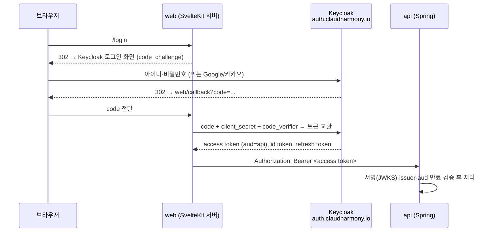

## 2. 구성도

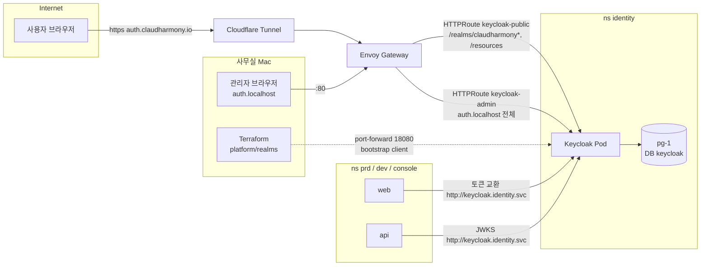

**공개 범위를 경로로 나눈 이유:** Keycloak 공식 권장 구성입니다. 인터넷에는 로그인에 필요한 `/realms/<공개 realm>`, `/resources`만 엽니다. `/admin`과 `/realms/master`는 공개 주소에서 `https://claudharmony.io/`로 302 리다이렉트됩니다. 관리 콘솔은 `auth.localhost`(Cloudflare 터널이 받지 않는 호스트)에서만 열립니다.

| 요청 (Host: auth.claudharmony.io) | 결과 |
|---|---|
| `/realms/claudharmony/.well-known/openid-configuration` | 200 |
| `/realms/claudharmony-dev/account` | 200 |
| `/admin/`, `/realms/master/...`, `/` | 302 → https://claudharmony.io/ |
| `/realms/claudharmony-devx/` (비슷한 이름) | 302 — Gateway API PathPrefix는 경로 **단위**로 비교 |

## 3. Terraform — 왜 스택이 두 개인가

| 스택 | provider | 만드는 것 |
|------|----------|-----------|
| `platform/identity` | kubernetes, kubectl, random | Namespace, DB(CNPG), bootstrap Secret, Deployment, Service, HTTPRoute 2개 |
| `platform/realms` | **keycloak**, kubernetes, random | realm 2개, role, client 3종, 계정, 앱 Namespace Secret, (소셜 로그인) |

Keycloak provider는 **이미 떠 있는 Keycloak**에 로그인해야 동작합니다. 한 스택에 넣으면 "서버가 아직 없는데 서버에 접속하는 provider"가 되어 첫 apply가 실패합니다. 그래서 서버와 설정을 나눴습니다. (cluster → gateway를 나눈 것과 같은 이유입니다. [5. Kubernetes 가이드](05-kubernetes-guide.md))

```bash
scripts/infra.sh identity apply   # 서버 (첫 기동 1~2분)
scripts/infra.sh realms apply     # 설정
scripts/infra.sh identity status
```

`realms` 스택이 Keycloak에 닿는 방법:
- `*.localhost` 주소는 브라우저만 127.0.0.1로 풀어 줍니다(macOS 시스템 DNS는 못 풂). 그래서 `infra.sh`가 실행하는 동안만 `kubectl port-forward svc/keycloak 18080:80`을 엽니다.
- 인증은 첫 기동 때 만든 **bootstrap client**(`terraform-bootstrap`, client_credentials)로 합니다. 비밀은 Secret `identity/keycloak-bootstrap`에 있고, 저장소에는 없습니다.

## 4. 설치 과정 (스크린샷)

### 4-1. 서버 — `platform/identity`

핵심 환경변수:

| 변수 | 값 | 이유 |
|------|----|------|
| `KC_HOSTNAME` | `https://auth.claudharmony.io` | 토큰 issuer를 항상 공개 주소로 고정 |
| `KC_HOSTNAME_ADMIN` | `http://auth.localhost` | 관리 콘솔 주소 분리 |
| `KC_HOSTNAME_BACKCHANNEL_DYNAMIC` | `true` | 클러스터 안 앱은 `http://keycloak.identity.svc`로 토큰 교환·JWKS 요청 |
| `KC_HTTP_ENABLED` / `KC_PROXY_HEADERS` | `true` / `xforwarded` | TLS는 Cloudflare에서 끝나고, 원래 https인지는 헤더로 앎 |
| `KC_CACHE` | `local` | 1대 운영. 여러 대로 늘리면 `ispn` |
| `KC_BOOTSTRAP_ADMIN_CLIENT_ID/SECRET` | Secret | 사람 계정 대신 **Terraform 전용 client**로 시작 |

- Probe는 관리 포트 9000의 `/health/started|ready|live`를 씁니다. 9000번은 Gateway에 연결하지 않습니다.
- 메모리: limit 1Gi, 실제 사용량 약 560Mi (JVM이 limit의 약 70%까지 힙으로 씀)

### 4-2. 설정 — `platform/realms`

관리 콘솔 로그인 화면입니다(`http://auth.localhost/admin/`). 계정은 Terraform이 만든 `claudharmony-admin`입니다.

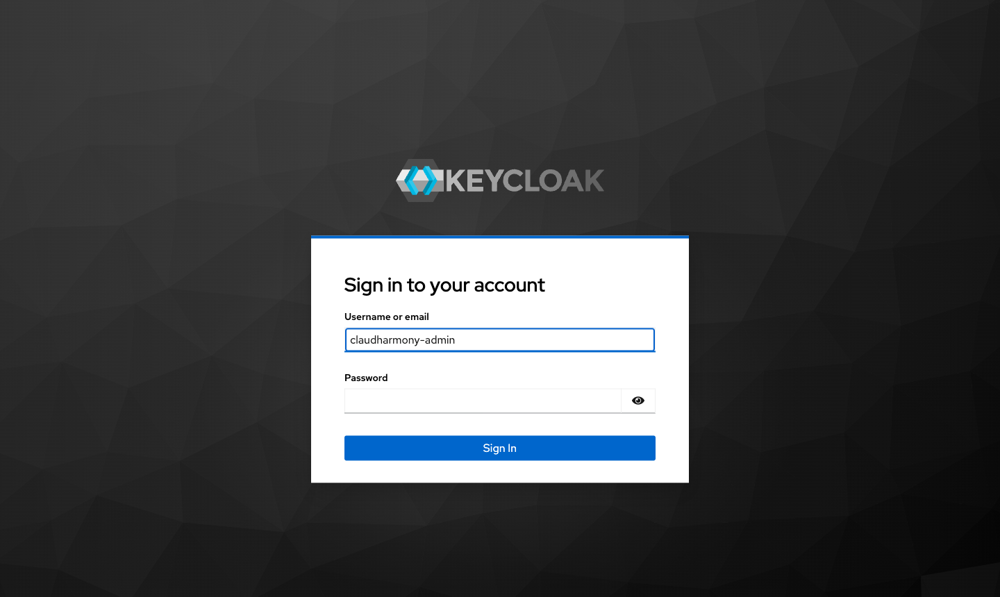

Terraform으로 만든 realm 목록입니다. `master`는 관리용이고, 서비스용은 prd와 dev를 따로 둡니다. 사용자·세션이 환경끼리 섞이지 않습니다.

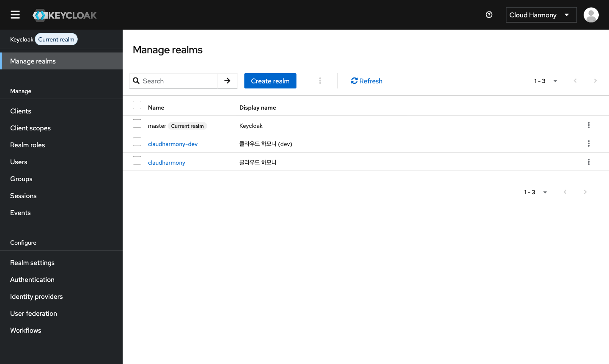

realm 기본 설정입니다(표시 이름 "클라우드 하모니").

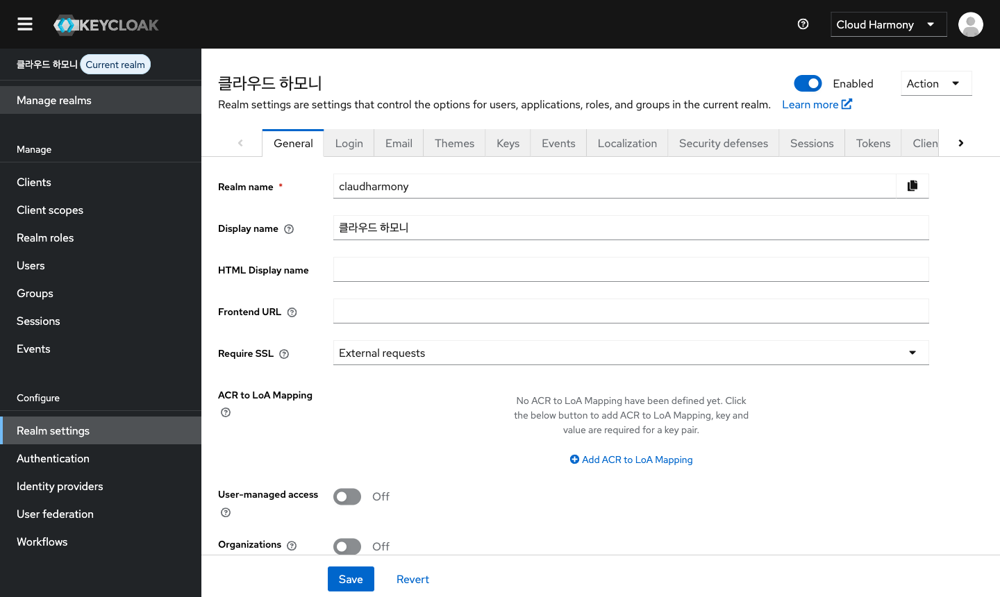

로그인 화면 언어는 한국어가 기본입니다.

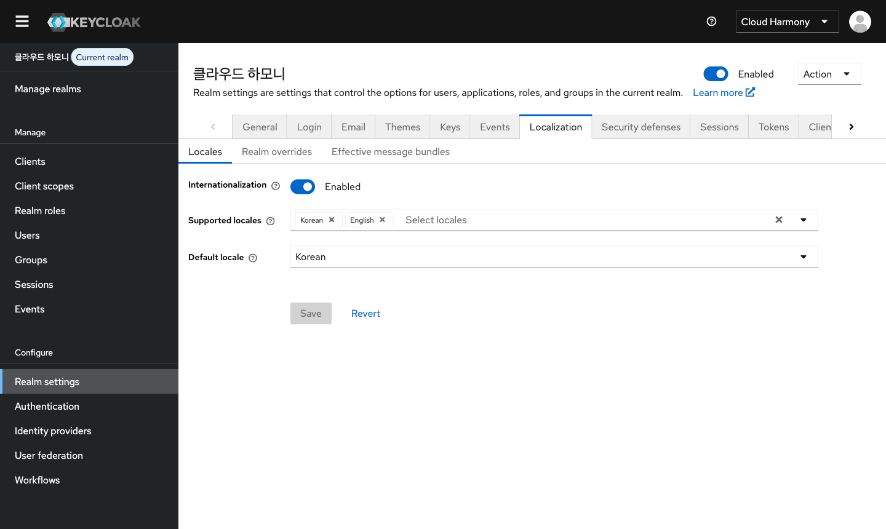

client 목록입니다. 여기에 `web`, `api`, `console`이 추가되었습니다.

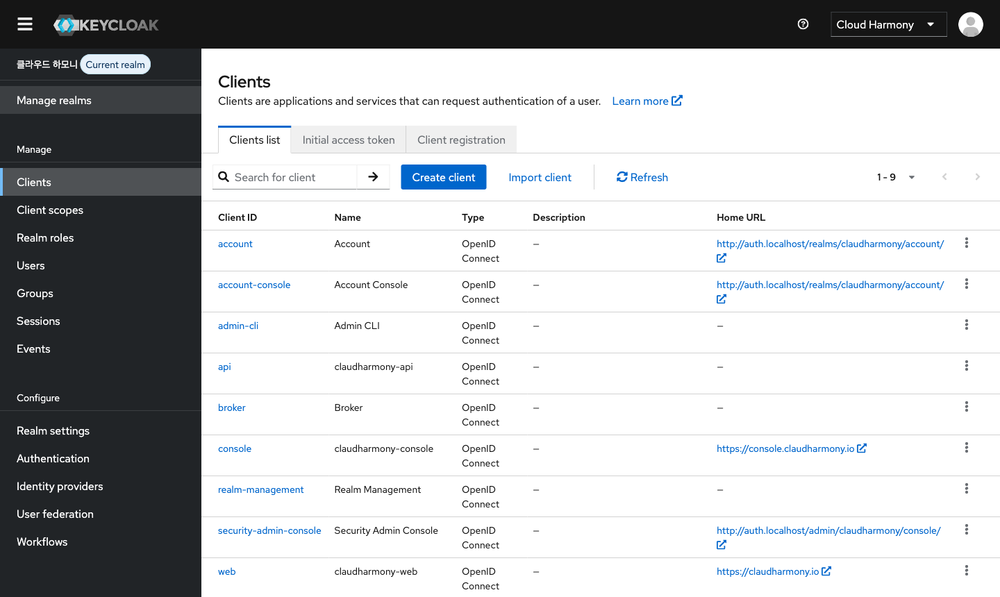

`web` client입니다. 로그인 후 돌아올 주소(redirect URI)를 환경별로 제한합니다. 목록에 없는 주소로는 토큰이 나가지 않습니다.

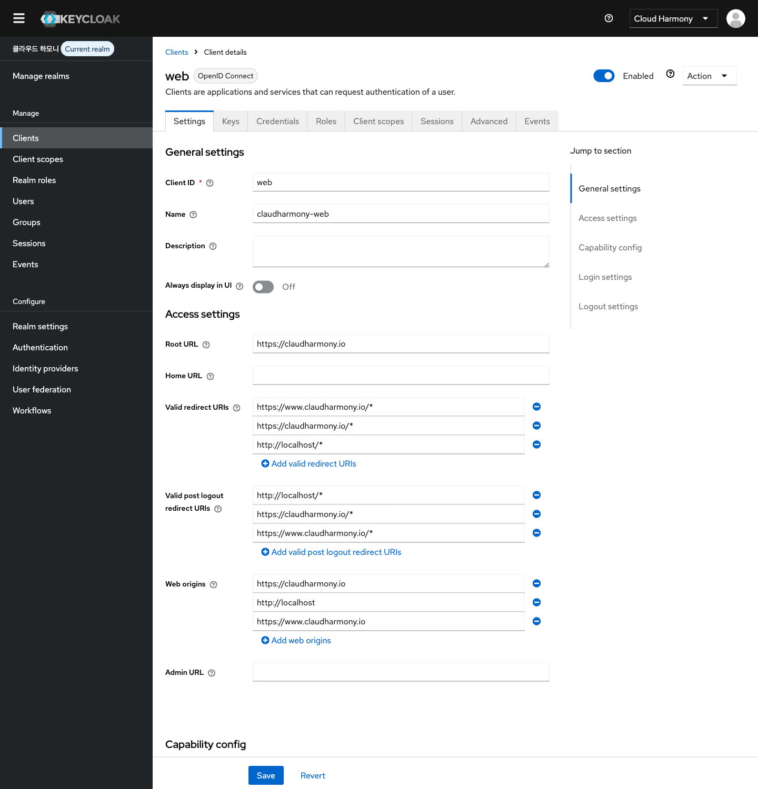

역할입니다. `user`는 가입 시 기본으로 붙고, `admin`은 콘솔 로그인용입니다.

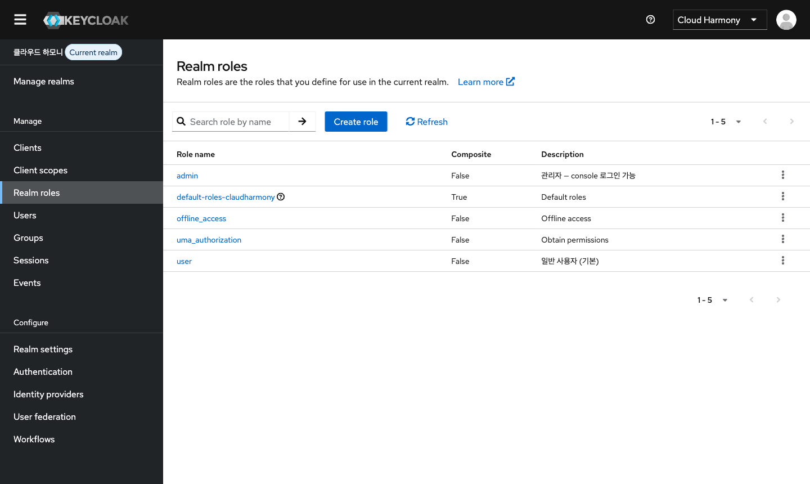

소셜 로그인(Identity Provider) 목록입니다. 키를 받으면 Terraform이 추가합니다([7. 소셜 로그인](#7-소셜-로그인-추가)).

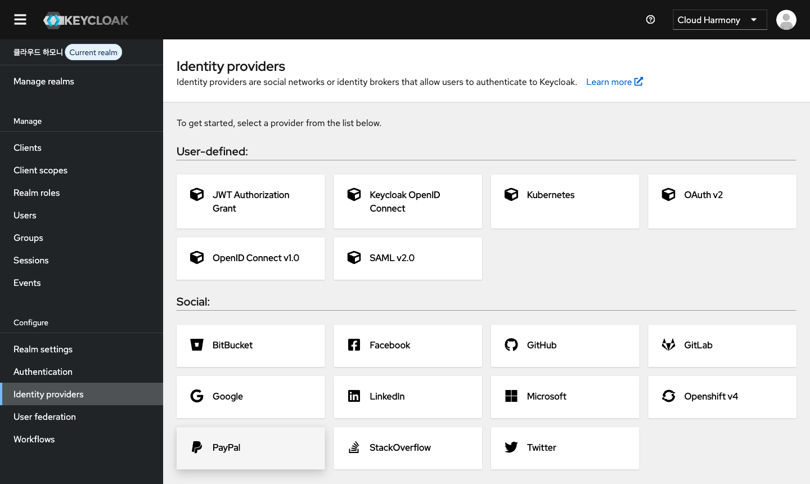

dev realm의 확인용 사용자 `tester`입니다. 비밀번호는 Secret `dev/keycloak-tester`에 있습니다.

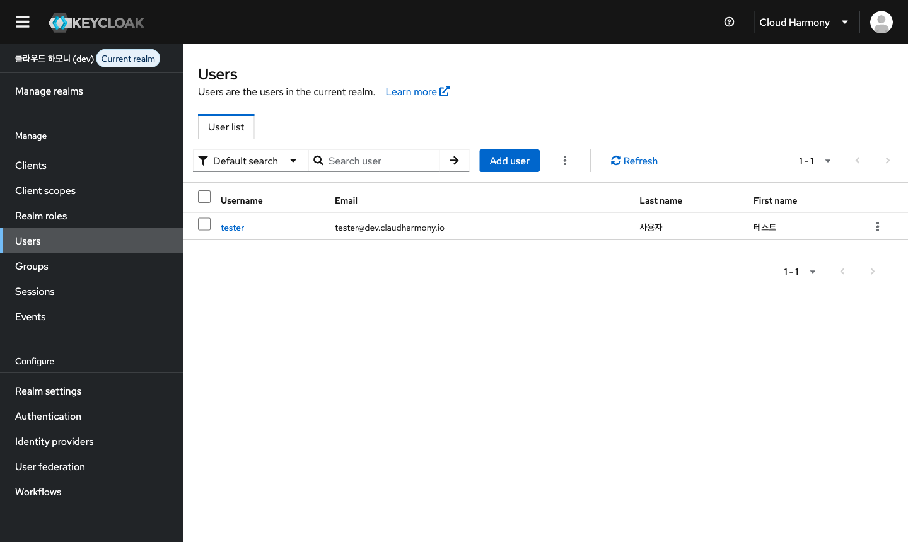

### 4-3. 공개 주소 — `platform/edge`

`hostnames`에 `auth.claudharmony.io`를 추가하면 DNS 레코드(proxied CNAME → 터널)와 터널 ingress가 함께 생깁니다. Gateway가 호스트 이름으로 Keycloak HTTPRoute를 고릅니다.

```bash
scripts/infra.sh edge apply   # Cloudflare 토큰 필요 — 사람이 직접 실행
```

### 4-4. 공개 로그인 화면 (인터넷)

`https://auth.claudharmony.io/realms/claudharmony-dev/account`에 들어가면 Keycloak 로그인 화면이 한국어로 나옵니다. 제목은 realm 표시 이름입니다. 로그인 화면 테마는 앱 세션의 claudharmony-keycloak 이미지로 바꿀 예정입니다([5-1](#5-1-커스텀-이미지-로그인-테마-배포)).

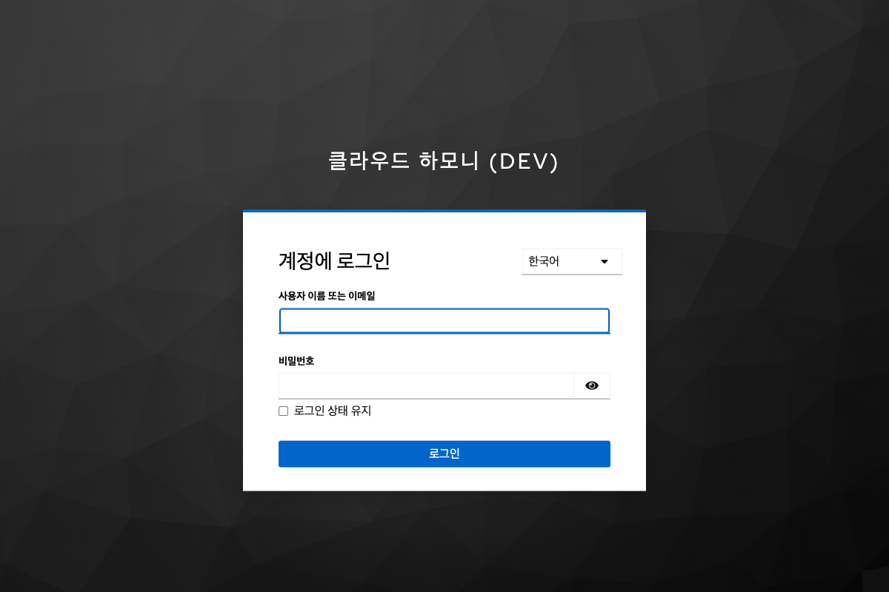

`tester`로 로그인한 뒤의 계정 화면입니다. 사용자는 여기서 자기 정보와 비밀번호를 관리합니다.

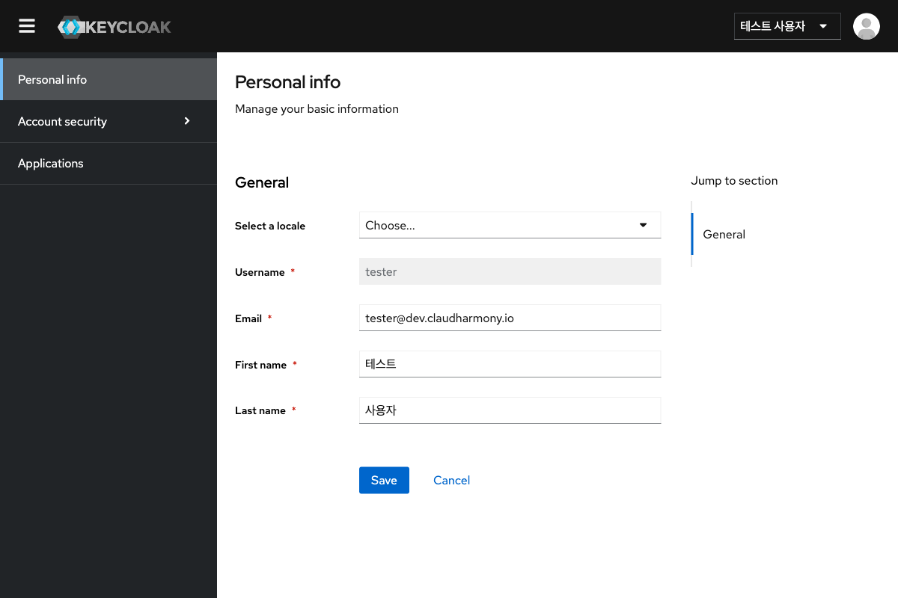

## 5. 운영

```bash
# 관리자 비밀번호 → 클립보드
kubectl -n identity get secret keycloak-admin -o jsonpath='{.data.password}' | base64 -d | pbcopy
# dev 테스트 사용자 비밀번호
kubectl -n dev get secret keycloak-tester -o jsonpath='{.data.password}' | base64 -d; echo
# 로그 / 상태
scripts/infra.sh identity status
kubectl -n identity logs deploy/keycloak --tail 100
```

| 항목 | 방법 |
|------|------|
| 설정 변경 | 콘솔에서 바꾸지 말고 `platform/realms` 수정 → apply. 콘솔 변경은 다음 apply 때 되돌아감 (관리자 비밀번호만 예외: `ignore_changes`) |
| 업그레이드 | `keycloak_image` 버전 변경 → `identity apply`. 배포 전략이 `Recreate`라 1~2분 로그인 불가. 마이너 버전은 DB 스키마를 자동 마이그레이션 |
| 백업 | Keycloak의 상태는 전부 DB `identity/pg`에 있음 → 앱 DB와 같은 백업 계획(Barman → R2, 예정)에 포함 |
| 늘리기 | `replicas` 2 이상 + `KC_CACHE=ispn` + `KC_CACHE_STACK=kubernetes`(headless Service 필요) |

## 5-1. 커스텀 이미지 (로그인 테마) 배포

테마·확장은 앱 세션의 저장소 [claudharmony-keycloak](https://github.com/ParkSeWoo/claudharmony-keycloak)(private)에 있습니다. 공식 26.7.5 이미지에 테마 `claudharmony`를 넣고, 같은 빌드 옵션(`KC_DB=postgres`, health, metrics)으로 `kc.sh build`한 이미지입니다.

```bash
# claudharmony-keycloak 저장소 main 배포 워크플로(self-hosted runner)가 실행
scripts/deploy.sh identity keycloak claudharmony/keycloak:<YYYYMMDD-sha>
#   → kind load → platform/identity/images.auto.tfvars.json 기록 → identity apply → rollout 확인 → 기록 커밋
```

- `platform/identity`는 `images.keycloak`이 있으면 그 이미지를 쓰고, 없으면 공식 이미지(`keycloak_image`)를 씁니다.
- Keycloak은 **한 대를 dev·prd realm이 같이 씁니다.** 이미지 배포는 main(또는 release)에서만 합니다. 배포 전략이 `Recreate`라서 1~2분 동안 로그인이 안 됩니다.
- 테마 켜기는 realm별로 합니다(`platform/realms` 변수 `realms.<env>.login_theme`). **이미지가 먼저 배포된 다음에** dev realm부터 `"claudharmony"`로 켜고, 확인한 뒤 prd를 켭니다. 이미지에 없는 테마를 지정하면 로그인 화면이 오류를 냅니다.

## 6. 앱 연동 계약

인프라(`platform/realms`)가 각 Namespace에 Secret을 넣어 줍니다. 앱은 이 키만 환경변수로 받으면 됩니다. client secret이 바뀌어도 앱 코드는 그대로입니다.

| Namespace | Secret | 키 |
|-----------|--------|----|
| prd, dev | `keycloak-web` | `issuer-uri`, `internal-uri`, `client-id`(=web), `client-secret` |
| prd, dev | `keycloak-api` | `issuer-uri`, `jwk-set-uri`(클러스터 안 주소), `audience`(=api) |
| console | `keycloak-console` | `issuer-uri`, `internal-uri`, `client-id`(=console), `client-secret` — prd realm, `admin` 역할만 허용 예정 |
| dev | `keycloak-tester` | `username`, `password` (확인용) |

- **issuer**는 항상 공개 주소입니다. 브라우저가 보는 주소와 토큰 안의 `iss`가 같아야 합니다.
- 서버끼리 통신(토큰 교환, JWKS)은 `internal-uri`·`jwk-set-uri`로 클러스터 안에서 끝납니다. 터널을 거치지 않습니다.
- Spring 예 (api, Resource Server):
  ```yaml
  spring.security.oauth2.resourceserver.jwt:
    issuer-uri: ${KEYCLOAK_ISSUER_URI}     # iss 검증
    jwk-set-uri: ${KEYCLOAK_JWK_SET_URI}   # 키는 클러스터 안에서
    audiences: ${KEYCLOAK_AUDIENCE}
  ```
- 서비스 카탈로그(`services.auto.tfvars.json`)의 `secret_env`로 Deployment에 연결합니다. 앱이 준비되면 앱 세션과 맞춥니다.

## 7. 소셜 로그인 추가

1. 각 서비스 개발자 콘솔에서 OAuth 앱을 만들고, redirect URI 두 개를 등록합니다:
   - `https://auth.claudharmony.io/realms/claudharmony/broker/<alias>/endpoint`
   - `https://auth.claudharmony.io/realms/claudharmony-dev/broker/<alias>/endpoint`
   - `<alias>` = `google` | `github` | `kakao` | `naver`
2. Mac에 `~/.claudharmony/identity.env`(chmod 600, 저장소 밖)를 만듭니다:
   ```bash
   GOOGLE_CLIENT_ID=...
   GOOGLE_CLIENT_SECRET=...
   KAKAO_CLIENT_ID=...        # 카카오: REST API 키, 보안 → Client Secret, 카카오 로그인 → OpenID Connect 활성화
   KAKAO_CLIENT_SECRET=...
   NAVER_CLIENT_ID=...        # 네이버 개발자센터 → 애플리케이션 등록 (네이버 로그인), Callback URL 위 두 개
   NAVER_CLIENT_SECRET=...
   ```
3. `scripts/infra.sh realms apply` — 값이 있는 것만 생깁니다(`social.tf`).

| 서비스 | 방식 | 상태 |
|--------|------|------|
| Google | Keycloak 내장 | 키 대기 |
| GitHub | Keycloak 내장 (`keycloak_oidc_github_identity_provider`) | 키 대기 |
| 카카오 | 표준 OIDC (`kauth.kakao.com`) | 키 대기 |
| 네이버 | OIDC 미지원 → Keycloak 기본 **OAuth 2.0** 공급자(`provider_id = oauth2`), 사용자 정보는 `response.id/email/name` (앱 세션 제공 설정). alias `naver` 고정 — 테마 버튼 색 | 키 대기 |

## 8. 막혔던 곳

| 증상 | 원인 | 해결 |
|------|------|------|
| Keycloak Pod 재시작 2회 | DB(CNPG)보다 먼저 떠서 접속 실패 | Deployment에 `depends_on = [module.db]` |
| 관리 콘솔이 빈 화면 | 관리 콘솔은 `auth.localhost`인데, master realm 로그인은 공개 주소(`KC_HOSTNAME`)로 감. 그 경로는 일부러 막아 둠 | master realm **Frontend URL**만 `http://auth.localhost`로 덮어씀 (`terraform_data` + REST) |
| Terraform이 `auth.localhost`에 못 붙음 | `*.localhost`는 브라우저만 풀어 줌 | `infra.sh realms`가 port-forward를 열고 닫음 |
| 공개 주소 리다이렉트가 `http://`로 나감 | RequestRedirect에 scheme 미지정 → 요청 scheme(http, 터널 안쪽)을 따라감 | `scheme = "https"` |
| `client_auth_method` 인자 없음 | provider 5.10에는 그 인자가 없음 | `extra_config = { clientAuthMethod = ... }` |
| edge apply 자동 실행 거부 | 공개 DNS 변경이라 자동 권한 검사가 차단 | 사람이 직접 실행 |
| 로그인 직후 `/token` 403 `Invalid origin`, 로그에 "Non-secure context" | Cloudflare는 `X-Forwarded-Proto: https`를 보내지만 **Envoy가 자기 연결(http) 기준으로 덮어씀** → Keycloak이 http로 판단해 https Origin과 불일치 | 공개 HTTPRoute에 `RequestHeaderModifier`로 `X-Forwarded-Proto: https` 고정 (그 호스트는 터널=https로만 들어옴) |
| 계정 화면 "Something went wrong", `/account/...` 401 | `keycloak_default_roles`가 기본 역할을 **덮어씀** → `account/view-profile`·`manage-account`가 빠져 토큰에 aud=account 없음 | default_roles에 `account/*` 두 개를 다시 포함 |
| 전체 장애 (prd·dev 502/530) | Docker VM 7.65GB에 여러 프로젝트 + Keycloak → swap 고갈 | Docker Desktop 메모리 20GB로 증설 ([작업 기록 #41, #43](07-worklog.md)) |

## 9. 다음

- [x] `auth.claudharmony.io` DNS (edge apply, 사용자 실행) — 공개 경로 200, `/admin`·master 302 확인
- [x] 공개 로그인 화면·로그인 후 계정 화면 확인 (스크린샷 4-4)
- [ ] 소셜 로그인 키 등록 (Google·카카오부터)
- [ ] 앱 연동 (앱 세션): web 로그인, api JWT 검증, console `admin` 역할 → Cloudflare Access 대신 Keycloak으로 콘솔 보호
- [ ] SMTP (비밀번호 재설정·이메일 인증)
- [ ] bootstrap client를 영구 `terraform` 서비스 계정으로 교체
- [~] 로그인 화면 테마 — 이미지 `20261024-39bdf59` 배포, dev realm 적용. 데스크톱 카드 정렬 수정 후 prd
